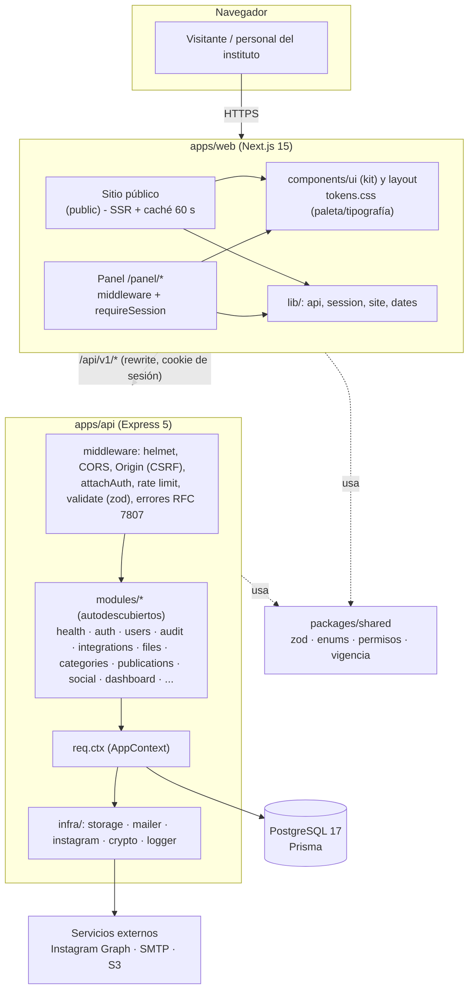
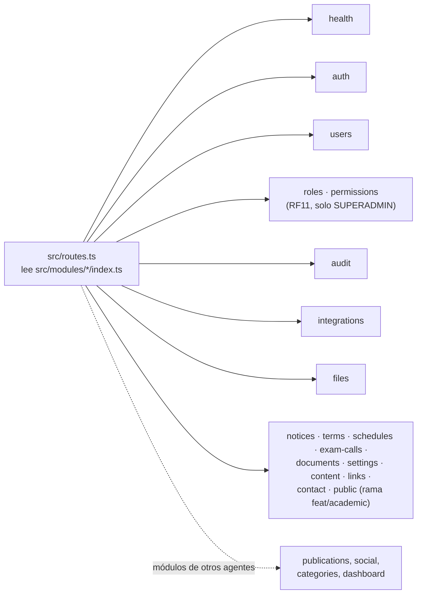
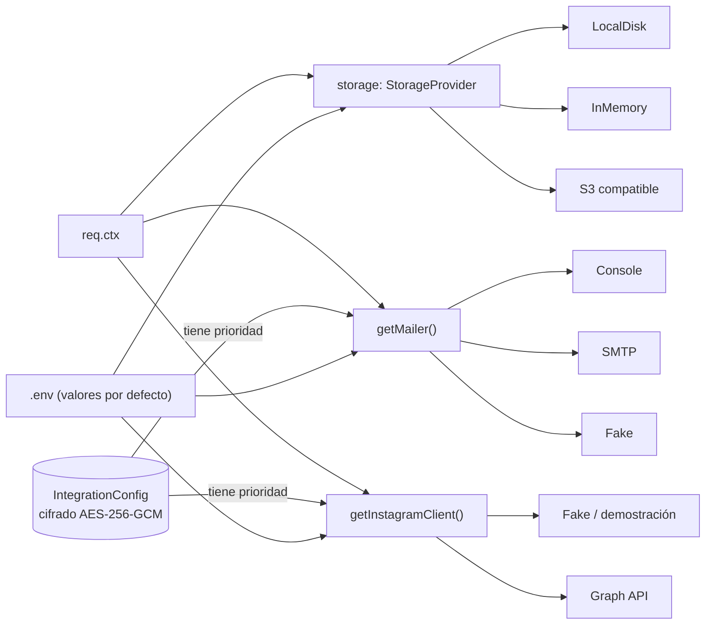

# Arquitectura

Visión general de capas, módulos y flujos. Complementa `docs/specs/03-arquitectura-y-estructura.md` y los ADR de `docs/decisiones/`.

## Capas

## Cómo se arma una petición

1. El navegador llama a `/api/v1/...` en el origen de la web; Next lo reenvía a la API (la cookie de sesión queda de primer nivel). Los Server Components llaman directo a la API y reenvían la cookie.
2. La API aplica: `helmet`, CORS (solo `APP_ORIGIN`), límite de tamaño, verificación de `Origin` en métodos mutantes, `attachAuth` (cookie -> sesión en base, hash del token) y luego el router del módulo.
3. El módulo valida con zod (`validate`), exige permiso (`requirePermission`, permisos efectivos del rol, leídos de la base en cada pedido; catálogo en `packages/shared`), usa servicios solo desde `req.ctx`, audita (`audit.fromReq`) y responde. Cualquier error sale como Problem Details.

## Módulos de la API

Cada carpeta exporta `{ mountPath, router }`; agregar un módulo no requiere editar archivos compartidos (`apps/api/README.md`).

**Roles y permisos (RF11, ADR-031).**

- **Catálogo.** El catálogo de acciones es fijo y vive en `packages/shared/src/permissions.ts`.
- **Roles.** Los roles y sus permisos son datos: tablas `Role` y `RolePermission`.
- **Lectura en cada pedido.** `attachAuth` carga los permisos efectivos del rol en cada pedido, así que un cambio rige sin volver a iniciar sesión.
- **Superadministrador.** SUPERADMIN tiene todo por código.
- **Lógica compartida.** La anti-escalada y la regla del último SUPERADMIN están en `modules/roles/roles.service.ts` y las usan `roles` y `users`.
- **Control automático.** `test/api/route-permissions.test.ts` falla si alguna ruta del panel no declara permiso.

## Servicios con interfaz, configurables sin tocar código

- Instagram y correo: **el cliente** los configura desde el panel (se guardan cifrados); el `.env` es solo valor por defecto. Almacenamiento: por entorno.
- Se resuelven **en cada uso** (no se cachean) para que los cambios del panel apliquen al instante.
- Sin configuración real: modo demostración (`GET /health` -> `demoMode: true`).

## Modelo de datos (resumen)

`User`/`Session` (auth) · `Publication` ⇄ `SocialPost` (moderación de Instagram) · `Notice` · `Document` (archivo) · `AcademicTerm` -> `Schedule`/`ExamCall` (solo visibles si su ciclo es el público) · `SiteSetting`/`ContentSection`/`ExternalLink` (datos institucionales y contenido) · `ContactMessage` · `IntegrationConfig` · `AuditLog`. Esquema ejecutable: `prisma/schema.prisma`.

### Bloque académico (avisos, ciclos, horarios, llamados, archivo, ajustes y sitio público)

- **Revalidación bajo demanda:** el middleware `apps/api/src/middleware/revalidate-web.ts` avisa a la web (`POST {APP_ORIGIN}/api/revalidate`, secreto `REVALIDATE_SECRET`) tras cada mutación exitosa del panel; la ruta `apps/web/src/app/api/revalidate/route.ts` invalida las etiquetas `public` y `settings` de la caché ISR. Así un cambio se ve al instante y el sitio conserva la caché de 60 s para el resto de las visitas (RNF05/RNF09). Es "dispara y olvida": si la web no responde no pasa nada.
- `public` solo lee y aplica la vigencia en dos capas (filtro SQL + funciones de `@ifts2/shared`); responde con `Cache-Control` corto + `stale-while-revalidate` (RNF09).
- `documents` es el único dueño de los archivos: avisos, horarios y llamados solo guardan `documentId`; la clave de almacenamiento no sale de la API y la descarga es por URL firmada.
- `terms` garantiza un único ciclo público (índice parcial + transacción); `schedules`/`exam-calls` solo se ven si su ciclo es el público.
- `contact` guarda siempre el mensaje antes de intentar el correo (RNF03).
- Contrato de respuestas tipado en `packages/shared/src/academic.ts`; detalle por módulo en `apps/api/src/modules/<m>/README.md`.

## Reglas de negocio transversales

- **Vigencia**: se calcula al consultar con las funciones de `packages/shared/src/visibility.ts` (`visibleFrom` inclusivo, `visibleUntil` exclusivo; fechas de fin dadas como día = 23:59:59.999 hora de Buenos Aires).
- **Un único ciclo público**: índice único parcial en la base + regla en servicio.
- **Eliminar**: solo manual, con confirmación, auditada y solo sobre contenido no vigente; 409 si está referenciado.
- **Permisos**: una sola matriz (`PERMISSIONS`) usada por la API y por la web para ocultar opciones.
- **Seguridad**: argon2id, sesiones revocables en base (solo el hash del token), cookie `httpOnly` + `SameSite=Lax` (+ `Secure` en HTTPS), 5 intentos fallidos / 15 min, secretos cifrados.
