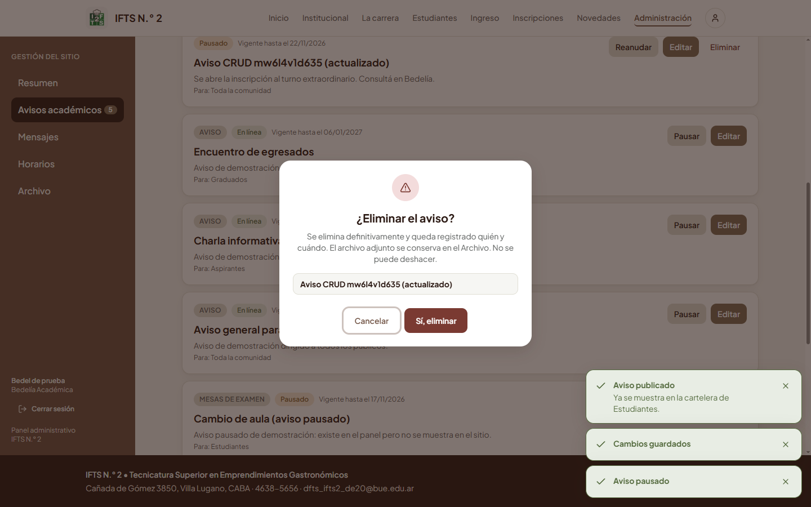
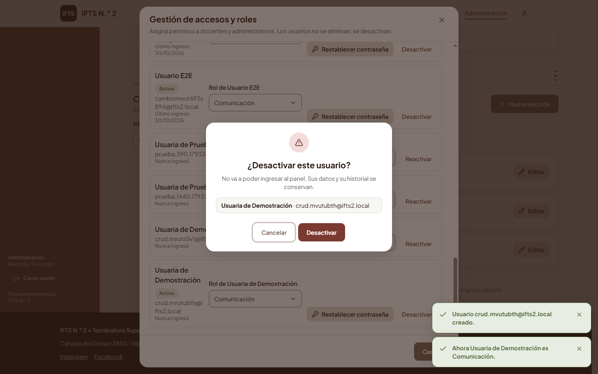

# Evidencias de pruebas y CRUD

Este documento reúne las pruebas que pide la consigna de la Etapa 3: **tres pruebas unitarias** y **dos de integración**, cada una con _qué se probó_, _resultado esperado_, _resultado obtenido_ y la evidencia. Todas las salidas fueron **generadas ejecutando las pruebas el 30/10/2026** sobre el código entregado y copiadas sin editar (los archivos originales están en `docs/evidencias/`). Al final hay un resumen de **todas** las suites del proyecto y la matriz de **CRUD**.

## 1. Cómo reproducir las pruebas

```bash
pnpm db:up                                   # la base de pruebas (ifts2_test) vive en el mismo contenedor
pnpm test                                    # unitarias (shared) + pruebas de API contra PostgreSQL
pnpm --filter @ifts2/shared exec vitest run test/visibility.test.ts --reporter=verbose
pnpm --filter @ifts2/api exec vitest run test/unit/crypto.test.ts --reporter=verbose
pnpm --filter @ifts2/api exec vitest run test/api/integracion-catedra.test.ts --reporter=verbose
pnpm e2e --build                             # Cypress (interfaz real) a 390 y 1440 px
```

Herramientas: **Vitest 5** (ejecutor y aserciones), **Supertest 7** (pedidos HTTP contra la aplicación Express real, sin red) y **PostgreSQL 17** real (base `ifts2_test`, que se vacía antes de cada prueba). **No se usan dobles de la base de datos**; solo se reemplazan los servicios externos (correo, Instagram y almacenamiento por versiones falsas o en memoria).

## 2. Pruebas unitarias

Una prueba unitaria verifica una pieza mínima de código (una función) de forma aislada, sin base de datos ni red.

### UT-1 · Regla de visibilidad de un aviso por vigencia

|                          |                                                                                                                                                                     |
| ------------------------ | ------------------------------------------------------------------------------------------------------------------------------------------------------------------- |
| **Archivo**              | `packages/shared/test/visibility.test.ts` (función `isNoticeVisible`, en `packages/shared/src/visibility.ts`)                                                       |
| **Qué se probó**         | Que un aviso solo sea visible cuando corresponde: activo y dentro de sus fechas. Se prueban los casos vigente, vencido, pausado, que todavía no empezó y el borde del último día (un fin dado como día incluye hasta las 23:59 de Buenos Aires y deja de valer a las 00:00 del día siguiente). |
| **Por qué importa**      | Es la regla central del producto: la vigencia se calcula al consultar, sin tareas programadas. Una falla acá mostraría avisos vencidos o escondería avisos vigentes.   |
| **Resultado esperado**   | `true` solo para activo y en ventana (incluido 23:59 BA); `false` para vencido, pausado, futuro y 00:00 BA del día siguiente.                                         |
| **Resultado obtenido**   | Las 5 pruebas pasan: el comportamiento coincide con lo esperado en todos los casos.                                                                                 |

Código (fragmento):

```ts
it('vencido (visibleUntil pasado) no es visible', () => {
  expect(isNoticeVisible({ status: 'ACTIVE', visibleUntil: d('2026-10-01T00:00:00Z') }, NOW)).toBe(false);
});
it('PAUSED no es visible', () => {
  expect(isNoticeVisible({ status: 'PAUSED' }, NOW)).toBe(false);
});
it('un fin dado como día incluye todo el día en Buenos Aires', () => {
  const until = endOfDayBA('2026-11-25');
  expect(isNoticeVisible({ status: 'ACTIVE', visibleUntil: until }, d('2026-11-26T02:59:00Z'))).toBe(true); // 23:59 BA
  expect(isNoticeVisible({ status: 'ACTIVE', visibleUntil: until }, d('2026-11-26T03:00:00Z'))).toBe(false); // 00:00 BA del 26
});
```

Salida real de Vitest (`docs/evidencias/2026-10-30-entrega-UT1-vigencia.txt`):

```text
RUN  v5.0.5 C:/Users/zampa/Desktop/CURSOS/Tecnicatura/proyectos_2026/ifts2-plataforma/packages/shared

 ✓ test/visibility.test.ts > isNoticeVisible > ACTIVE dentro de vigencia es visible 4ms
 ✓ test/visibility.test.ts > isNoticeVisible > vencido (visibleUntil pasado) no es visible 0ms
 ✓ test/visibility.test.ts > isNoticeVisible > PAUSED no es visible 0ms
 ✓ test/visibility.test.ts > isNoticeVisible > aún no empezó: no es visible 0ms
 ✓ test/visibility.test.ts > isNoticeVisible > un fin dado como día incluye todo el día en Buenos Aires 1ms

 Test Files  1 passed (1)
      Tests  5 passed | 16 skipped (21)
   Start at  07:34:45
   Duration  456ms (import 59%, transform 28%, worker 7%, tests 6%)
```

### UT-2 · Validación zod de un aviso

|                          |                                                                                                                                                                     |
| ------------------------ | ------------------------------------------------------------------------------------------------------------------------------------------------------------------- |
| **Archivo**              | `packages/shared/test/schemas-permissions.test.ts` (esquema `noticeCreateInput`, en `packages/shared/src/schemas.ts`)                                              |
| **Qué se probó**         | Que el esquema de validación del aviso rechace un título vacío y una fecha de fin anterior a la de inicio, con mensajes claros en español; y que acepte una fecha escrita como día y la convierta al fin del día en Buenos Aires. |
| **Por qué importa**      | El mismo esquema valida en el navegador (mensaje bajo el campo) y en la API (la última palabra): cumple «campos obligatorios no vacíos» y «mensajes claros».          |
| **Resultado esperado**   | `success = false` con los mensajes «El título es obligatorio.» y «La fecha de fin debe ser posterior a la fecha de inicio.»; y `visibleUntil` = `2026-11-26T02:59:59.999Z` para `2026-11-25`. |
| **Resultado obtenido**   | Se obtuvieron exactamente esos mensajes y ese valor. Pasaron las 11 pruebas del grupo «esquemas zod: mensajes claros» (las dos de aviso y las de usuario, login, ciclo, llamado, publicación, moderación, contacto y ajustes). |

Código (fragmento):

```ts
it('aviso: título vacío y fin anterior al inicio', () => {
  const r = noticeCreateInput.safeParse({ title: '  ', body: 'x', visibleFrom: '2026-11-10', visibleUntil: '2026-11-01' });
  expect(r.success).toBe(false);
  expect(msgs(r)).toContain('El título es obligatorio.');
  expect(msgs(r)).toContain('La fecha de fin debe ser posterior a la fecha de inicio.');
});
```

Salida real de Vitest (`docs/evidencias/2026-10-30-entrega-UT2-zod-aviso.txt`):

```text
RUN  v5.0.5 C:/Users/zampa/Desktop/CURSOS/Tecnicatura/proyectos_2026/ifts2-plataforma/packages/shared

 ✓ test/schemas-permissions.test.ts > esquemas zod: mensajes claros > aviso: título vacío y fin anterior al inicio 8ms
 ✓ test/schemas-permissions.test.ts > esquemas zod: mensajes claros > aviso: acepta fechas como día y las lleva a Buenos Aires 2ms
 ✓ test/schemas-permissions.test.ts > esquemas zod: mensajes claros > usuario: correo inválido, rol inválido 2ms
 ✓ test/schemas-permissions.test.ts > esquemas zod: mensajes claros > usuario: normaliza el correo a minúsculas 1ms
 ✓ test/schemas-permissions.test.ts > esquemas zod: mensajes claros > login: campos obligatorios 2ms
 ✓ test/schemas-permissions.test.ts > esquemas zod: mensajes claros > ciclo: año obligatorio y período válido 1ms
 ✓ test/schemas-permissions.test.ts > esquemas zod: mensajes claros > llamado: fin anterior al inicio 1ms
 ✓ test/schemas-permissions.test.ts > esquemas zod: mensajes claros > publicación: evento con fin anterior al inicio 1ms
 ✓ test/schemas-permissions.test.ts > esquemas zod: mensajes claros > moderación: exige confirmar consentimiento 1ms
 ✓ test/schemas-permissions.test.ts > esquemas zod: mensajes claros > contacto: exige consentimiento 1ms
 ✓ test/schemas-permissions.test.ts > esquemas zod: mensajes claros > ajustes: hashtag se normaliza con # y rechaza claves desconocidas 1ms

 Test Files  1 passed (1)
      Tests  11 passed | 11 skipped (22)
   Start at  07:34:48
   Duration  396ms (import 53%, transform 25%, tests 15%, worker 6%)
```

### UT-3 · Cifrado y descifrado del token de Instagram

|                          |                                                                                                                                                                     |
| ------------------------ | ------------------------------------------------------------------------------------------------------------------------------------------------------------------- |
| **Archivo**              | `apps/api/test/unit/crypto.test.ts` (funciones `encrypt` y `decrypt` de `apps/api/src/infra/crypto.ts`, AES-256-GCM)                                                |
| **Qué se probó**         | Que el valor descifrado coincida con el original y que el texto cifrado no contenga el original; que cifrar dos veces lo mismo dé resultados distintos (IV aleatorio); que un dato **alterado** o una **clave distinta** hagan fallar el descifrado; que se exija una clave de 32 bytes; y el enmascarado de secretos. |
| **Por qué importa**      | Los secretos del cliente (token de Instagram, SMTP) se guardan cifrados en la base: el cifrado debe ser reversible solo con la clave y detectar cualquier manipulación. |
| **Resultado esperado**   | Ida y vuelta idéntica; textos cifrados distintos entre sí; error al alterar o usar otra clave; error con clave de 16 bytes; solo los últimos 4 caracteres visibles al enmascarar. |
| **Resultado obtenido**   | Las 7 pruebas pasan: se cumple cada comportamiento esperado.                                                                                                       |

Código (fragmento):

```ts
it('el valor descifrado coincide con el original', () => {
  const token = 'IGQWRPtoken-de-larga-duracion-123456';
  const enc = encrypt(token, key);
  expect(enc).not.toContain(token);
  expect(decrypt(enc, key)).toBe(token);
});
it('un token alterado falla al descifrar', () => {
  const enc = encrypt('secreto', key);
  const parts = enc.split('.');
  const data = Buffer.from(parts[3]!, 'base64url');
  data[0] = data[0]! ^ 0xff;
  parts[3] = data.toString('base64url');
  expect(() => decrypt(parts.join('.'), key)).toThrow();
});
```

Salida real de Vitest (`docs/evidencias/2026-10-30-entrega-UT3-cifrado.txt`):

```text
RUN  v5.0.5 C:/Users/zampa/Desktop/CURSOS/Tecnicatura/proyectos_2026/ifts2-plataforma/apps/api

 ✓ test/unit/crypto.test.ts > cifrado AES-256-GCM del token de Instagram > el valor descifrado coincide con el original 5ms
 ✓ test/unit/crypto.test.ts > cifrado AES-256-GCM del token de Instagram > cifrar dos veces el mismo valor produce resultados distintos (IV aleatorio) 1ms
 ✓ test/unit/crypto.test.ts > cifrado AES-256-GCM del token de Instagram > un token alterado falla al descifrar 2ms
 ✓ test/unit/crypto.test.ts > cifrado AES-256-GCM del token de Instagram > una clave distinta falla al descifrar 1ms
 ✓ test/unit/crypto.test.ts > cifrado AES-256-GCM del token de Instagram > exige una clave de 32 bytes 1ms
 ✓ test/unit/crypto.test.ts > cifrado AES-256-GCM del token de Instagram > JSON ida y vuelta 1ms
 ✓ test/unit/crypto.test.ts > cifrado AES-256-GCM del token de Instagram > maskSecret muestra solo los últimos 4 caracteres 0ms

 Test Files  1 passed (1)
      Tests  7 passed (7)
   Start at  07:34:51
   Duration  3.87s (setup 27%, import 26%, transform 17%, tests 16%, worker 13%, environment 1%)
```

## 3. Pruebas de integración

Una prueba de integración verifica que varios módulos funcionen **juntos**. Estas dos recorren la aplicación real: pedido HTTP → middleware (sesión, permisos, validación zod) → lógica de negocio → **PostgreSQL** → sitio público. Están en `apps/api/test/api/integracion-catedra.test.ts` (además, cada módulo de la API tiene su propio archivo de pruebas de integración; ver el resumen en la sección 4).

### INT-1 · Crear un aviso por la API impacta en la base y se ve en el sitio público

| Pasos | |
| --- | --- |
| 1 | Antes de crear nada, `GET /api/v1/public/students` (sin sesión) devuelve 200 y **cero avisos**. |
| 2 | Bedelía inicia sesión y hace `POST /api/v1/notices` con título, texto, destinatarios «Estudiantes», urgente y vencimiento en 10 días. |
| 3 | Se consulta **directamente la tabla `Notice`** en PostgreSQL: la fila existe con los datos enviados y como autor el usuario de la sesión. |
| 4 | Se verifica que haya una fila en `AuditLog` con la acción `notice.create`. |
| 5 | `GET /api/v1/public/students` (sin sesión) ahora devuelve el aviso creado. |

|                        |                                                                                                                              |
| ---------------------- | ---------------------------------------------------------------------------------------------------------------------------- |
| **Resultado esperado** | Paso 2: **201** con `status: ACTIVE` y `visibleNow: true`. Paso 3: fila en la base. Paso 4: 1 registro de auditoría. Paso 5: el aviso figura en el sitio público. |
| **Resultado obtenido** | Se cumplieron los cinco pasos (la prueba pasa; salida más abajo).                                                              |

Código (fragmento):

```ts
const created = await request(t.app).post('/api/v1/notices').set('Cookie', bedelia.cookie).send({
  title: 'Inscripción al turno extraordinario', body: 'Del 1 al 10 de diciembre en Bedelía.',
  audience: 'STUDENTS', urgent: true, visibleUntil: fromNow(10 * DAY).toISOString(),
});
expect(created.status).toBe(201);
const row = await testPrisma.notice.findUnique({ where: { id: created.body.id } });   // consulta directa a la base
expect(row).toMatchObject({ title: 'Inscripción al turno extraordinario', audience: 'STUDENTS', status: 'ACTIVE', authorId: bedelia.user.id });
expect(await testPrisma.auditLog.count({ where: { action: 'notice.create' } })).toBe(1);
const after = await request(t.app).get('/api/v1/public/students');                    // lo que ve el público
expect(after.body.notices.map((n) => n.title)).toEqual(['Inscripción al turno extraordinario']);
```

### INT-2 · Eliminar un aviso con confirmación: 204 y auditoría; 409 si está vigente

La **confirmación** es un paso de la interfaz (el diálogo «¿Eliminar el aviso?»); la API recibe el `DELETE` solo después de confirmar y aplica además su propia regla: **solo se elimina lo no vigente**. La captura de la interfaz está en la sección 5 (CRUD · Avisos · Eliminar).

| Pasos | |
| --- | --- |
| 1 | Se crean dos avisos vigentes por la API: «Aviso vigente» y «Aviso a eliminar». |
| 2 | `DELETE` del aviso **vigente**: debe rechazarse. Se verifica que el aviso **sigue existiendo** en la base. |
| 3 | Se **pausa** el otro aviso (`POST /notices/:id/pause`) y se hace `DELETE`: debe aceptarse. |
| 4 | Se verifica en la base que la fila **ya no existe** y que `AuditLog` tiene `notice.delete` con el id y el usuario que lo eliminó. |
| 5 | El sitio público solo conserva el aviso vigente. |

|                        |                                                                                                                              |
| ---------------------- | ---------------------------------------------------------------------------------------------------------------------------- |
| **Resultado esperado** | Paso 2: **409** con un mensaje que menciona «vigente». Paso 3: pausar → 200 y eliminar → **204**. Paso 4: 0 filas y 1 registro de auditoría. Paso 5: solo «Aviso vigente». |
| **Resultado obtenido** | Se cumplieron todos los pasos (la prueba pasa). El mensaje real de la API para el 409 es: «No se puede eliminar un aviso vigente. Pausalo o esperá a que venza.» |

Código (fragmento):

```ts
const rechazado = await request(t.app).delete(`/api/v1/notices/${vigente.id}`).set('Cookie', bedelia.cookie);
expect(rechazado.status).toBe(409);
expect(await testPrisma.notice.count({ where: { id: vigente.id } })).toBe(1);        // sigue existiendo
await request(t.app).post(`/api/v1/notices/${aEliminar.id}/pause`).set('Cookie', bedelia.cookie);
const eliminado = await request(t.app).delete(`/api/v1/notices/${aEliminar.id}`).set('Cookie', bedelia.cookie);
expect(eliminado.status).toBe(204);
expect(await testPrisma.notice.count({ where: { id: aEliminar.id } })).toBe(0);      // ya no está en la base
const log = await testPrisma.auditLog.findFirst({ where: { action: 'notice.delete' } });
expect(log).toMatchObject({ entityId: aEliminar.id, userId: bedelia.user.id });       // quedó auditado
```

Salida real de Vitest + Supertest para INT-1 e INT-2 (`docs/evidencias/2026-10-30-entrega-INT-integracion.txt`):

```text
RUN  v5.0.5 C:/Users/zampa/Desktop/CURSOS/Tecnicatura/proyectos_2026/ifts2-plataforma/apps/api

 ✓ test/api/integracion-catedra.test.ts > INT-1 · crear un aviso por la API impacta en la base y se ve en el sitio público > POST /notices -> fila en PostgreSQL -> aparece en GET /public/students 695ms
 ✓ test/api/integracion-catedra.test.ts > INT-2 · eliminar un aviso (acción confirmada): 204 y auditoría; 409 si está vigente > un aviso pausado se elimina (204), desaparece de la base y queda auditado; uno vigente da 409 374ms

 Test Files  1 passed (1)
      Tests  2 passed (2)
   Start at  07:27:37
   Duration  6.42s (import 50%, tests 42%, transform 7%, setup 1%)
```

Además, la prueba E2E de interfaz que recorre este mismo flujo con el diálogo de confirmación es `E2E-16` (`apps/web/cypress/e2e/panel-a/avisos.cy.ts`), incluida en la corrida de Cypress de la sección 4.

## 4. Resumen de todas las pruebas del proyecto

Corrida de la entrega (30/10/2026), sobre el código entregado, en la máquina de desarrollo (Windows 10, Node 24, PostgreSQL 17 en Docker):

| Suite | Herramienta | Resultado | Evidencia |
| --- | --- | --- | --- |
| **Unitarias de `packages/shared`** (vigencia, permisos, esquemas, mensajes) | Vitest | 43 pruebas en 2 archivos, todas aprobadas | `docs/evidencias/2026-10-30-entrega-pnpm-test.txt` |
| **API: unitarias e integración** (25 archivos: cifrado, configuración, almacenamiento, Markdown, cliente de Instagram, y un archivo por módulo contra PostgreSQL) | Vitest + Supertest | 352 pruebas en 25 archivos, todas aprobadas | `docs/evidencias/2026-10-30-entrega-pnpm-test.txt` |
| **Total unitarias + API** | | **395 pruebas aprobadas, 0 fallas** | |
| **Extremo a extremo (interfaz real, 390 y 1440 px, con axe)** | Cypress 16 | 190 pruebas en 19 archivos, todas aprobadas (7 min 12 s) | `docs/evidencias/2026-10-30-entrega-cypress.txt` |
| **Flujos de negocio H1–H8 y seguridad** (HTTP real contra el build de producción) | `pnpm verify` | 33 de 33 comprobaciones en verde | `docs/evidencias/2026-10-30-entrega-flujos-y-seguridad.md` |
| **Carga** del sitio público (400 usuarios virtuales) | autocannon | Uso real: 133 pedidos/s, p95 525 ms, 0 errores 5xx; saturación documentada | `docs/evidencias/2026-10-30-carga-publico.md` |
| **Rendimiento y accesibilidad** (móvil) | Lighthouse | 4 páginas: rendimiento 97–99, accesibilidad 98–100 | `docs/evidencias/2026-10-30-lighthouse-movil.md` |
| **Calidad estática** | ESLint, Prettier, TypeScript estricto | sin errores | `docs/evidencias/2026-10-30-entrega-lint.txt`, `…-entrega-typecheck.txt` |

**Detalle de Cypress por archivo** (todas las pruebas se ejecutan a 390 y 1440 px; _tests_ = pruebas, _ok_ = aprobadas):

| Archivo | Tests | Ok |
| --- | ---: | ---: |
| `smoke.cy.ts` | 6 | 6 |
| `ui-kit.cy.ts` | 6 | 6 |
| `panel-a/avisos.cy.ts` | 16 | 16 |
| `panel-a/capturas-crud.cy.ts` | 4 | 4 |
| `panel-a/capturas.cy.ts` | 8 | 8 |
| `panel-a/login.cy.ts` | 18 | 18 |
| `panel-a/publicaciones.cy.ts` | 10 | 10 |
| `panel-a/roles-mensajes.cy.ts` | 10 | 10 |
| `panel-b/capturas-manual.cy.ts` | 6 | 6 |
| `panel-b/e2e-08-horarios.cy.ts` | 10 | 10 |
| `panel-b/e2e-09-10-12-15.cy.ts` | 10 | 10 |
| `panel-b/integraciones-a11y.cy.ts` | 8 | 8 |
| `public/capturas-contacto.cy.ts` | 1 | 1 |
| `public/capturas.cy.ts` | 15 | 15 |
| `public/contacto.cy.ts` | 13 | 13 |
| `public/degradacion.cy.ts` | 8 | 8 |
| `public/estudiantes.cy.ts` | 12 | 12 |
| `public/novedades.cy.ts` | 12 | 12 |
| `public/recorrido.cy.ts` | 17 | 17 |
| **Total (19 archivos)** | **190** | **190** |


### 4.1 Lo que esta evidencia NO cubre (limitaciones conocidas)

- **Instagram real:** `GraphInstagramClient` se probó **solo contra un servidor HTTP simulado** (paginación, errores 190/429/500, fallas de red, canje y renovación de token). No hubo cuenta profesional ni app de Meta para una prueba en vivo.
- **Correo SMTP real y almacenamiento S3 real:** no se probaron contra servicios reales (se usaron el correo falso y el almacenamiento local o en memoria).
- **Carga:** se usó **autocannon**, no k6. Un solo proceso de Node se satura a ~300–360 pedidos por segundo; con el uso real esperado (~133 pedidos/s) cumple los objetivos. Los escenarios de saturación con una sola página marcan «NO CUMPLE» en el informe y están documentados como límite.
- **Datos pendientes del cliente:** fechas y documentación de ingreso, y ubicación de las materias por año.

## 5. CRUD demostrable

La consigna exige las cuatro operaciones de persistencia con evidencias. A continuación, para cada entidad principal, **qué endpoint implementa cada operación, la regla que la protege, la prueba automática que la verifica y la captura**. Los pasos de uso están explicados en el **Manual de Usuario, sección 6**, con las capturas de cada paso; la prueba `apps/web/cypress/e2e/panel-a/capturas-crud.cy.ts` recorre estas operaciones con la interfaz real (4 pruebas, todas en verde) y genera las capturas.

| Entidad | Crear | Leer | Actualizar | Eliminar |
| --- | --- | --- | --- | --- |
| **Avisos** | `POST /notices` | `GET /notices`, `GET /notices/:id`, `GET /public/students` | `PATCH /notices/:id`, `POST …/pause` y `…/resume` | `DELETE /notices/:id` (solo pausado o vencido; vigente → 409) |
| **Publicaciones** | `POST /publications` | `GET /publications`, `GET /public/publications` | `PATCH /publications/:id`, publicar, pausar, reactivar | `DELETE /publications/:id` (borrador, pausada o vencida; vigente → 409) |
| **Documentos** | `POST /documents` (multipart) | `GET /documents`, `GET /documents/:id` | `POST …/archive` y `…/restore` (cambio de estado) | `DELETE /documents/:id` (solo archivados y sin uso; si no → 409) |
| **Usuarios** | `POST /users` | `GET /users` | `PATCH /users/:id` (rol), `POST …/reset-password` | `POST /users/:id/deactivate` (se **desactiva**, no se borra, para conservar la auditoría) |

### 5.1 Reglas de validación y control de errores

| Regla de la consigna | Cómo se cumple | Dónde se prueba |
| --- | --- | --- |
| **Evitar duplicados** | Correo de usuario único, ciclo (año + tipo) único, categoría (nombre + tipo) único, `externalId` de Instagram único. La API responde 409 y la pantalla muestra «Ya existe un usuario con ese correo». | `users.test.ts`, `terms.test.ts`, `categories.test.ts`, `social.test.ts`; Cypress E2E-12 y E2E-17 |
| **Campos obligatorios** | Esquemas zod compartidos: el navegador marca el campo y la API rechaza con 400 y `errors` por campo. | UT-2; `notices.test.ts` («valida: título y texto obligatorios…»); Cypress E2E-17 |
| **Confirmación antes de eliminar** | Un único diálogo de confirmación (`ConfirmDialog`) para toda baja; «Cancelar» no cambia nada. | Cypress E2E-16 (cancelar no elimina; confirmar elimina); capturas de la sección 6 del Manual de Usuario |
| **Solo se elimina lo no vigente** | La API devuelve 409 si está vigente o en uso; la interfaz ni siquiera ofrece «Eliminar». | INT-2; `notices.test.ts`, `publications.test.ts`, `documents.test.ts` |
| **Mensajes claros** | Los errores salen como Problem Details con un `detail` en español y la interfaz los muestra tal cual. | Pruebas de API de cada módulo; Cypress |
| **Auditoría** | Toda alta, cambio o baja registra quién y cuándo en `AuditLog`. | INT-1 e INT-2; `audit-health-files.test.ts` |

### 5.2 Capturas del CRUD

Las capturas de cada paso (crear, leer, actualizar y eliminar o desactivar) de avisos, publicaciones, documentos y usuarios están en el **Manual de Usuario, sección 6**, y como archivos en `docs/capturas/panel/crud-*-1440.png`. Se muestra aquí una muestra de la baja con confirmación:




