# Manual de Usuario

**Plataforma web del IFTS N.° 2** — sitio institucional y panel de gestión.

Este manual explica, paso a paso y con capturas, cómo usar el sitio (para quienes lo visitan) y el **panel de gestión** (para el personal del instituto). No hace falta saber de informática: las explicaciones usan las mismas palabras que ves en la pantalla.

## 1. Introducción

### 1.1 Para qué sirve

La plataforma reemplaza al sitio anterior del instituto y tiene dos partes:

- **El sitio público**: lo ven aspirantes, estudiantes y familias. Muestra información institucional, la carrera, los horarios y mesas de examen del ciclo vigente, los avisos académicos y las novedades.
- **El panel de gestión**: lo usa el personal del instituto para mantener el sitio al día sin pedirle ayuda a nadie: cargar avisos, horarios, llamados a examen, publicaciones, documentos y configuraciones.

### 1.2 Quién usa qué

| Persona                         | Rol en el panel                     | Qué puede hacer                                                                            |
| ------------------------------- | ----------------------------------- | ------------------------------------------------------------------------------------------ |
| Persona designada por la institución | **Superadministrador** (SUPERADMIN) | Todo lo de Administración, más **crear roles y elegir qué puede hacer cada uno** |
| Rectoría / Dirección            | **Administración** (ADMIN)          | Todo lo de abajo, usuarios (también puede crear otros administradores), configuración del sitio, ciclo público e integraciones. No define roles |
| Bedelía Académica               | **Bedelía** (BEDELIA)               | Avisos académicos, horarios, llamados a examen, archivo de documentos y mensajes de contacto |
| Comunicación                    | **Comunicación** (EDITOR)           | Publicaciones, moderación de Instagram y publicaciones propias                              |
| Aspirantes, estudiantes, familias | (no necesitan cuenta)             | Navegar el sitio público y enviar consultas                                                 |

Los permisos de cada rol los define el Superadministrador, así que lo que ves arriba es lo habitual y puede cambiar. El panel solo muestra las opciones que corresponden a tu rol. Si intentás entrar a una pantalla que no es tuya, verás el aviso «No tenés permiso».

### 1.3 Ideas que conviene tener claras

- **Nada se borra solo.** Cuando algo vence (por ejemplo un aviso), deja de verse en el sitio pero **sigue en el panel**: podés reactivarlo. Eliminar siempre es una decisión tuya y siempre te pide confirmación.
- **Nada de Instagram aparece en el sitio sin que alguien lo apruebe.**
- **Si Instagram o el correo fallan, el sitio sigue funcionando.**

## 2. Requisitos mínimos

- Una computadora, tablet o celular con un navegador actualizado (Chrome, Edge, Firefox o Safari). El sitio y el panel se adaptan al tamaño de la pantalla.
- Conexión a Internet.
- Para el panel: tu correo y tu clave (te las da el administrador). La primera vez que entres con una clave temporal, el sistema te pide cambiarla.
- Para subir archivos: PDF (hasta 10 MB) o imágenes JPG, PNG o WebP (hasta 5 MB).

## 3. El sitio público

### 3.1 Pantalla principal y menú

La barra de arriba tiene siempre los mismos accesos: **Inicio · Institucional · La carrera · Estudiantes · Ingreso · Inscripciones · Novedades · Administración** (este último lleva al panel). En el celular se abre con el botón de menú.

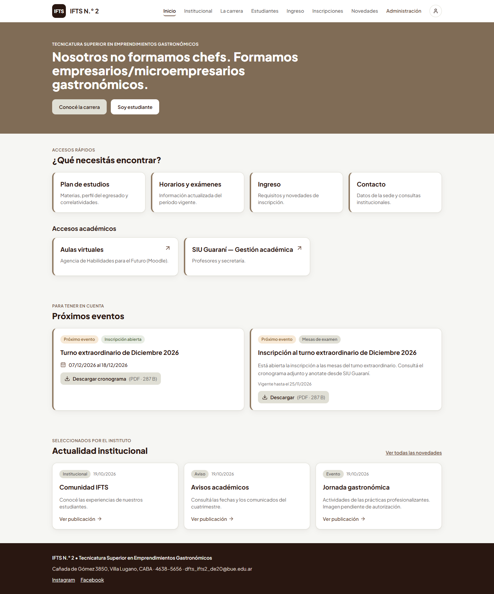

_Inicio: frase del instituto, accesos rápidos y las últimas novedades aprobadas._

| Sección           | Qué encontrás                                                                                                        |
| ----------------- | -------------------------------------------------------------------------------------------------------------------- |
| **Inicio**        | Presentación, accesos rápidos (SIU Guaraní, Aulas Virtuales, Mi Argentina) y novedades destacadas                    |
| **Institucional** | Quiénes somos, datos de la sede y el **formulario de contacto**                                                      |
| **La carrera**    | Plan de estudios, materias, horas y correlatividades                                                                 |
| **Estudiantes**   | El **ciclo lectivo vigente**: horarios por comisión, llamados y mesas de examen, avisos y enlaces útiles             |
| **Ingreso**       | Información para aspirantes a la tecnicatura: requisitos y pasos                                                     |
| **Inscripciones** | Para alumnos: inscripción a carreras y a exámenes                                                                    |
| **Novedades**     | Noticias y eventos, con filtros por año y categoría                                                                  |

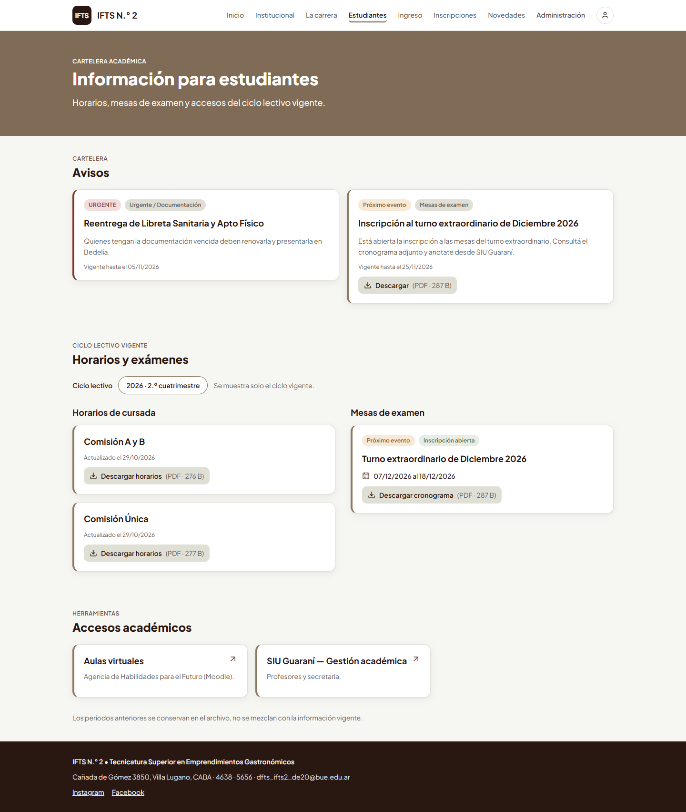

_Estudiantes: ciclo vigente, grillas de horarios para descargar, llamados a examen y avisos._

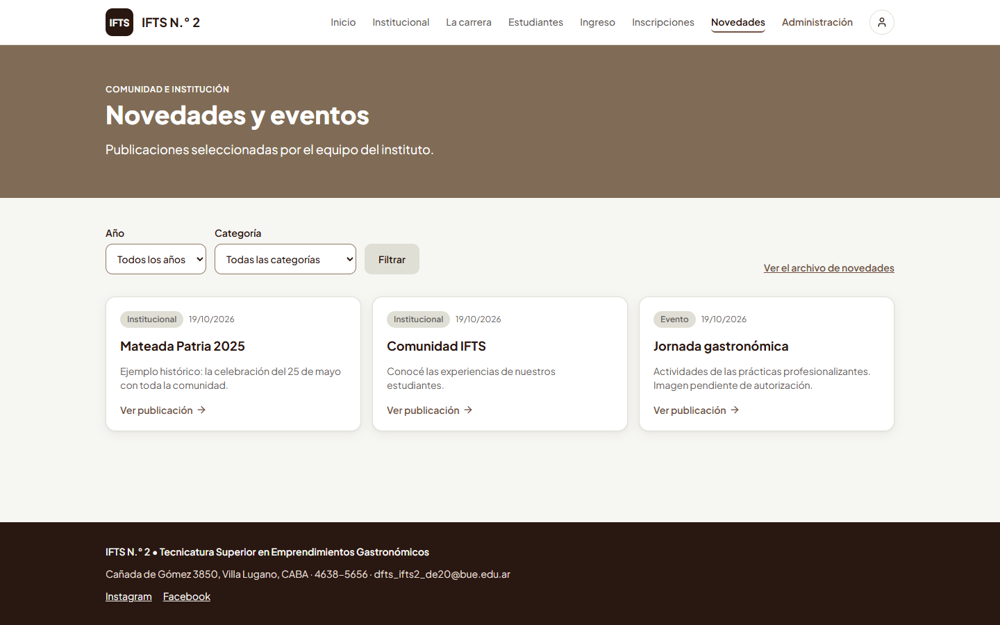

_Novedades: tarjetas con las publicaciones vigentes y filtros._

En el celular, el mismo contenido se acomoda en una columna:

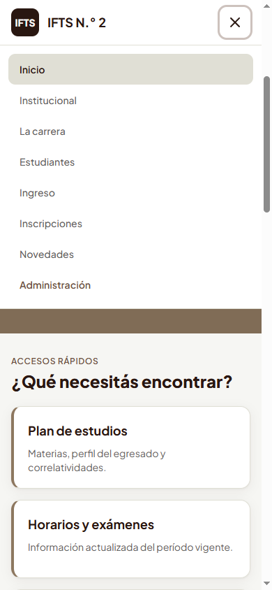

### 3.2 Enviar una consulta desde el sitio

1. Entrá a **Institucional** (o a `…/institucional#contacto`) y bajá hasta **Contacto**.
2. Completá **Nombre y apellido**, **Correo electrónico**, **Asunto** y **Consulta**. Todos son obligatorios.
3. Tildá la casilla «Acepto que el instituto use mis datos personales solo para responder esta consulta». Sin esto no se puede enviar.
4. Tocá **Enviar consulta**.
5. Vas a ver el mensaje **«Recibimos tu consulta»**. El personal la verá en su bandeja del panel.

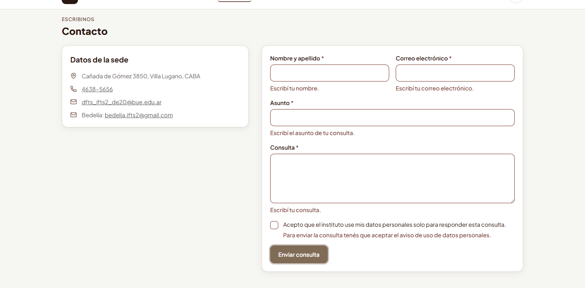

_Si dejás campos vacíos o no aceptás el aviso, el formulario te dice qué falta, sin borrar lo que ya escribiste._

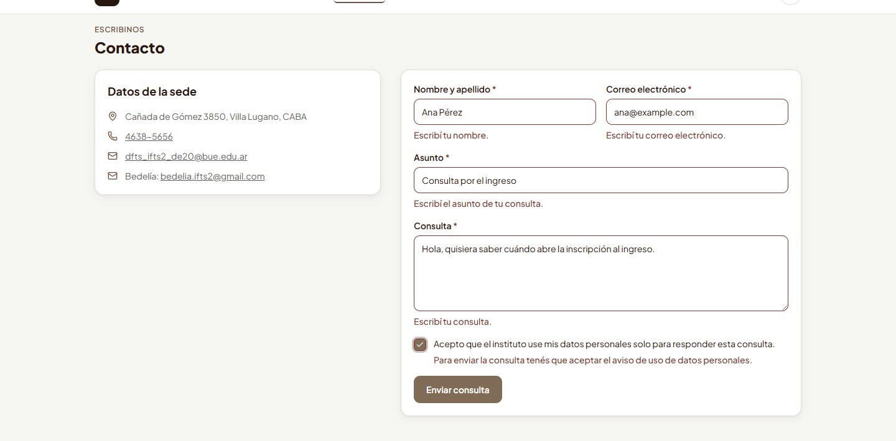

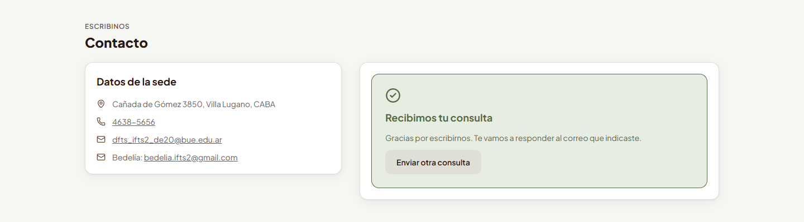

_Al enviar, el sitio confirma la recepción._

## 4. El panel de gestión

### 4.1 Ingresar y salir

1. Entrá a **Administración** (en el menú del sitio) o directamente a `…/panel`.
2. Escribí tu **correo** y tu **clave** y tocá **Ingresar al panel**.
3. Si tu clave es temporal (te la dio el administrador), el sistema te pide elegir una nueva.
4. Para salir, usá **Cerrar sesión** (abajo en el menú lateral; en el celular, dentro del menú).

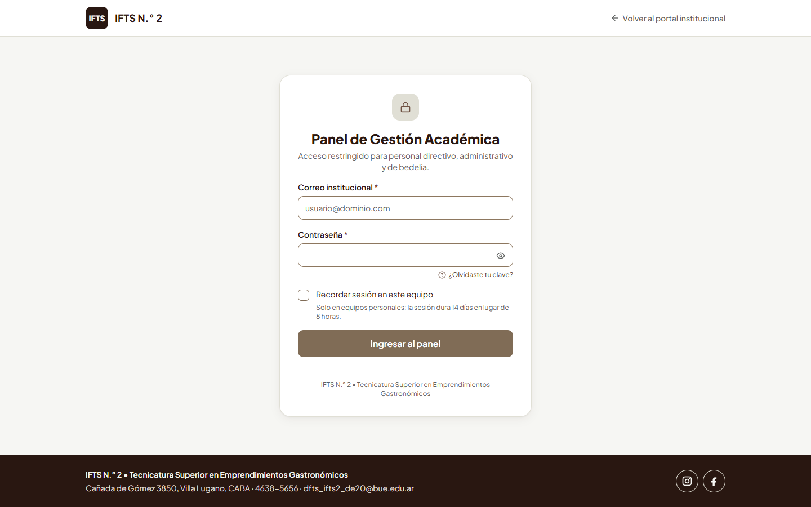

_Ingreso al panel._

Si te equivocás de clave verás «Correo o contraseña incorrectos.». Tras **5 intentos fallidos seguidos** el acceso se bloquea unos minutos por seguridad. Si olvidaste tu clave, tocá **¿Olvidaste tu clave?** y pedísela al administrador (él te genera una temporal).

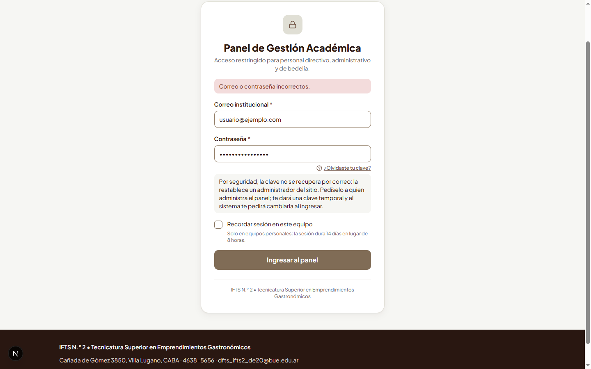

### 4.2 Pantalla principal (Resumen) y menú

Al ingresar ves el **Resumen**: el estado de Instagram, cuántas publicaciones esperan moderación, avisos activos o por vencer, el ciclo público y el próximo llamado a examen. Los bloques cambian según tu rol.

La tarjeta **Ingreso** muestra el ciclo de ingreso **estimado** (año del período vigente + 1) y el estado de la página de Ingreso: **Sin publicar** (no tiene contenido visible), **A confirmar** (algún texto tiene la marca `[a confirmar ...]`) o **Publicada**. Para completarla, editá los textos en Configuración -> Contenido de páginas -> Ingreso y quitá la marca cuando el dato esté confirmado.

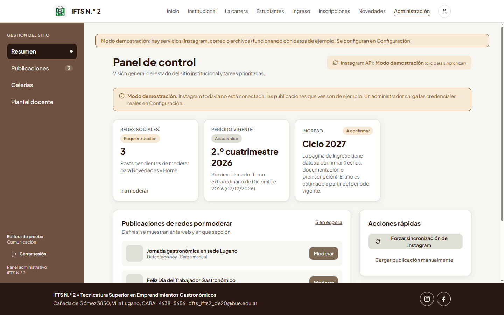

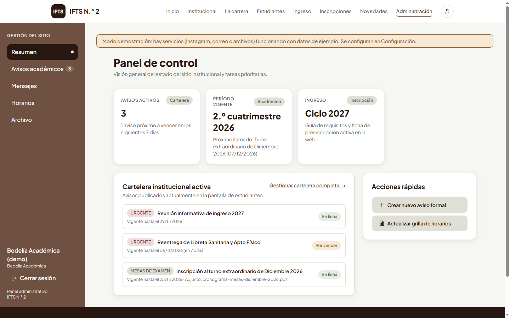

El **menú lateral** (a la izquierda; en el celular se abre con el botón de menú) tiene, según tu rol:

| Opción               | Para qué                                                                                   | Quién la ve              |
| -------------------- | ------------------------------------------------------------------------------------------ | ------------------------ |
| **Resumen**          | Vista general y accesos rápidos                                                            | Todos                    |
| **Publicaciones**    | Moderar Instagram y administrar las publicaciones propias del sitio                        | Comunicación, Administración |
| **Avisos académicos**| Crear, pausar y administrar avisos                                                         | Bedelía, Administración  |
| **Mensajes**         | Bandeja de consultas enviadas desde el sitio                                               | Bedelía, Administración  |
| **Horarios**         | Ciclo público, grillas por comisión y llamados a examen                                    | Bedelía, Administración  |
| **Archivo**          | Documentos históricos: buscar, restaurar, archivar y eliminar                              | Bedelía, Administración  |
| **Configuración**    | Datos de la sede, usuarios y roles, contenido, enlaces e integraciones                     | Administración           |

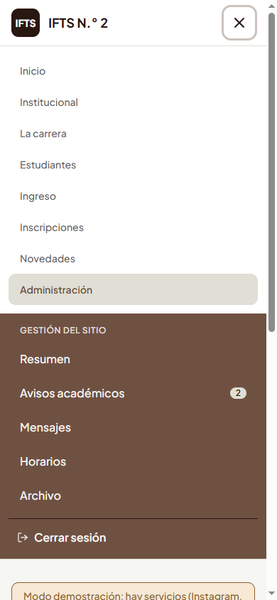

_En el celular el menú se abre desde la esquina._

Un cartel amarillo arriba avisa **«Modo demostración»** cuando Instagram, el correo o los archivos todavía usan datos de ejemplo. Se resuelve en **Configuración → Integraciones** (sección 5.8).

## 5. Flujos de uso paso a paso

Todas las confirmaciones del panel funcionan igual: aparece una ventana que explica qué va a pasar con dos botones, **Cancelar** (no hace nada) y el botón de acción (por ejemplo «Sí, publicar»). Al terminar, un cartel verde en la esquina confirma lo hecho.

### 5.1 Moderar una publicación de Instagram _(Comunicación)_

El sistema detecta publicaciones de la cuenta del instituto con el hashtag acordado y las deja **pendientes**. Vos decidís cuáles se muestran en el sitio.

1. Entrá a **Publicaciones**. En la pestaña **De redes sociales** ves tres solapas: **Pendientes**, **Aprobadas** y **Descartadas**.
2. (Opcional) Tocá **Sincronizar con Instagram** para buscar publicaciones nuevas ahora.
3. En una publicación pendiente, tocá **Moderar**.
4. Revisá la imagen y el texto. Podés ajustar el **Título en el sitio**, el **Resumen**, la **Categoría**, dónde se muestra (**Novedades** y/o carrusel de **Inicio**) y las fechas **Visible desde / hasta**.
5. Tildá **«Confirmo que existe consentimiento para publicar imágenes de estudiantes»**. Es obligatorio.
6. Tocá **Aprobar y publicar en la web** y confirmá con **Sí, publicar**.
7. Si no corresponde publicarla, tocá **Descartar publicación** y confirmá con **Sí, descartar**. Una descartada se puede **restaurar** más adelante.

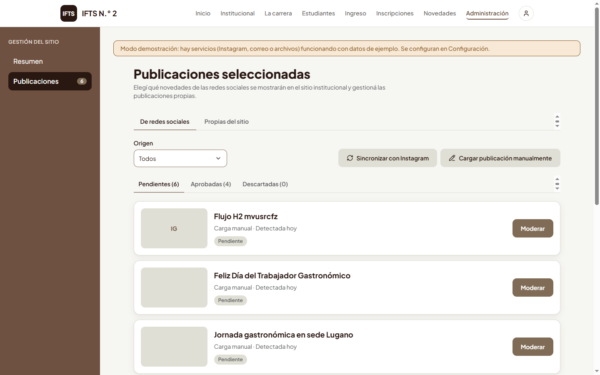

_Lista de publicaciones pendientes de moderación._

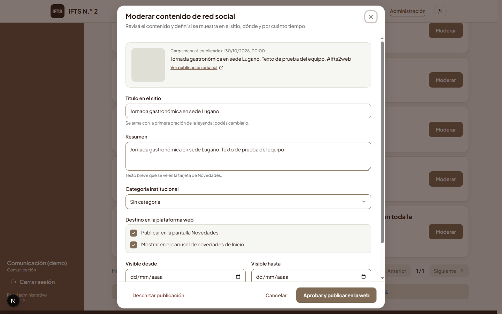

_Ventana de moderación: se edita lo que se va a ver en el sitio y se aprueba._

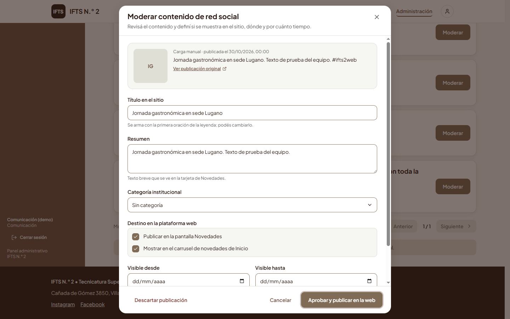

_Sin tildar el consentimiento, el sistema no deja publicar y lo explica._

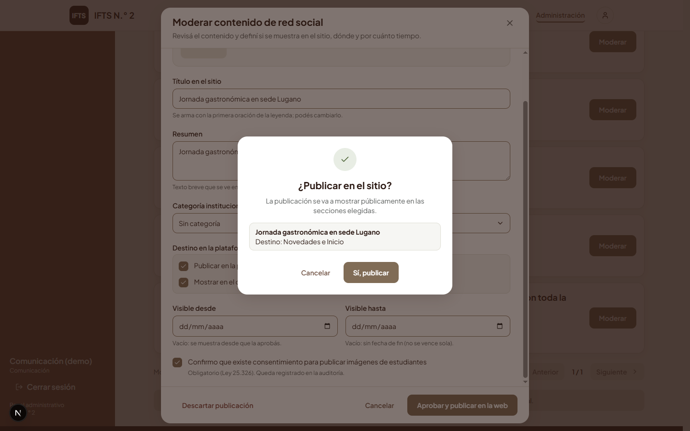

### 5.2 Cargar una publicación manual _(Comunicación)_

Hay dos casos: cargar una publicación de Instagram a mano (cuando la sincronización falla), o crear una **publicación propia** del sitio.

**a) Publicación de Instagram cargada a mano**

1. En **Publicaciones → De redes sociales**, tocá **Cargar publicación manualmente**.
2. Completá **Enlace a la publicación**, **Leyenda**, **Dirección de la imagen** y **Fecha de publicación** (todos obligatorios).
3. Tocá **Cargar publicación**. Queda como pendiente, igual que las detectadas, y se modera como en 5.1.

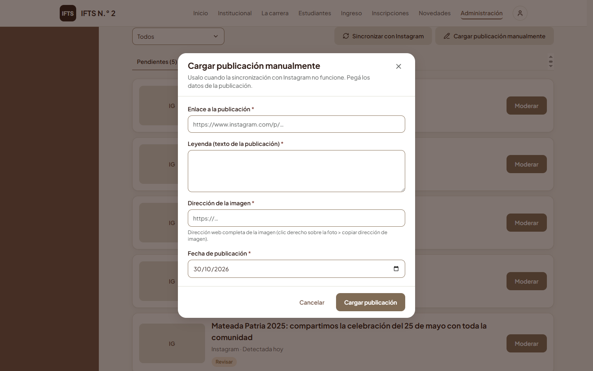

**b) Publicación propia del sitio**

1. Entrá a la pestaña **Propias del sitio** y tocá **Nueva publicación**.
2. Completá **Título** y **Resumen** (obligatorios) y, si querés, texto completo, categoría, imagen de portada y fechas de vigencia.
3. Tocá **Crear borrador**. Después, desde la lista, podés **Publicar**, **Pausar**, programarla, **Reactivar** o **Eliminar** (solo si no está vigente).

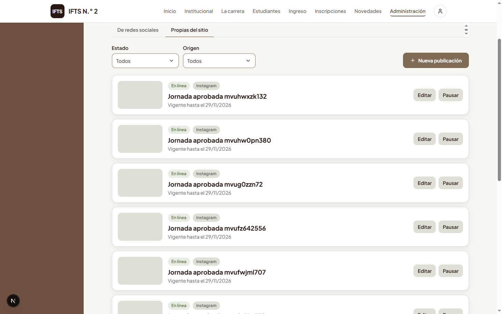

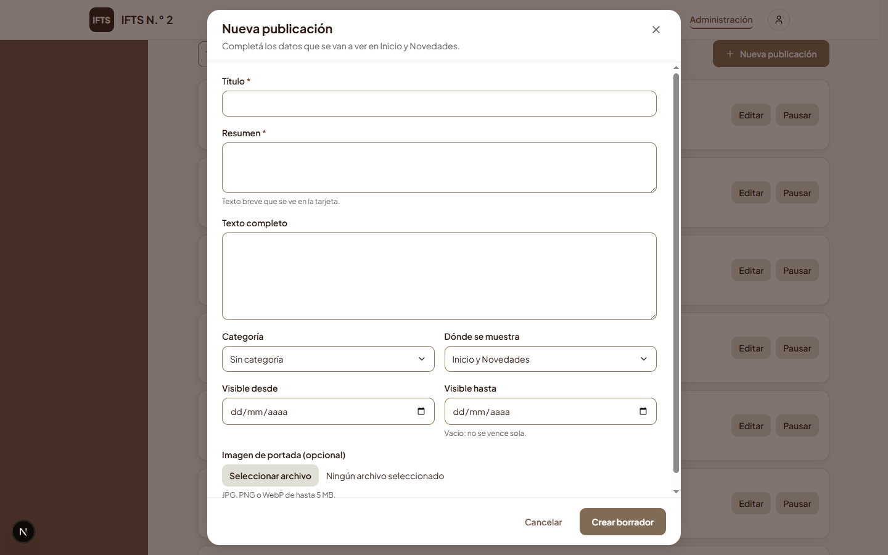

### 5.3 Crear y pausar un aviso _(Bedelía)_

**Crear**

1. Entrá a **Avisos académicos** y tocá **Nuevo aviso**.
2. Completá **Título del comunicado** y **Contenido del aviso** (obligatorios). Opcionalmente elegí destinatarios, categoría, un archivo adjunto (PDF o imagen), **Visible desde / hasta** y marcá **Marcar como urgente** si corresponde.
3. Tocá **Publicar aviso** y confirmá con **Sí, publicar**. El aviso aparece enseguida en **Estudiantes**.

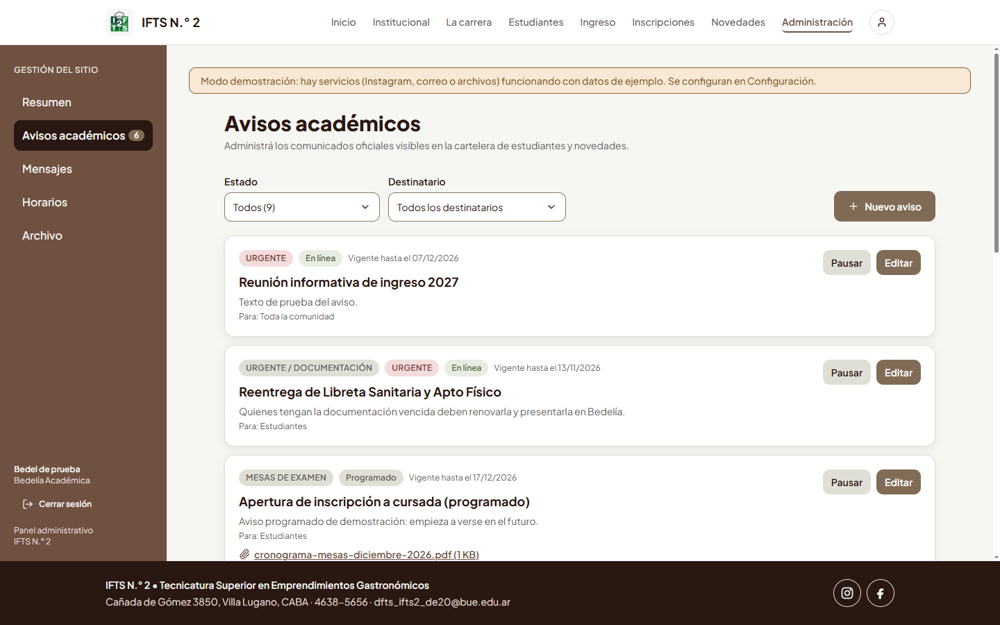

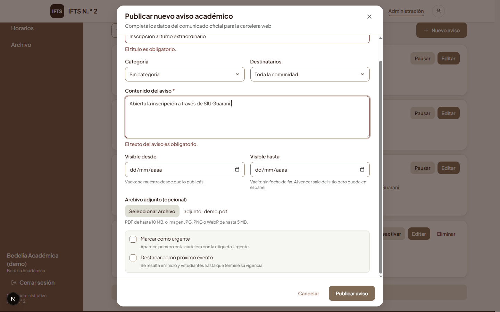

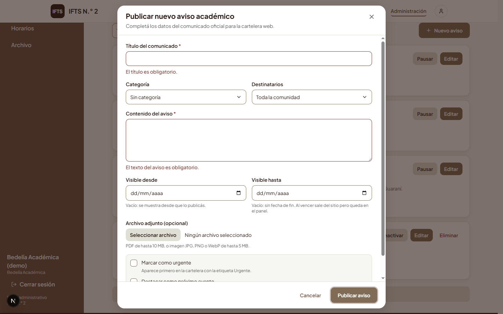

_Si falta el título o el texto, o si la fecha de fin es anterior a la de inicio, el formulario lo marca con un mensaje claro._

**Pausar y reanudar**

1. En la lista, en el aviso que querés sacar de circulación, tocá **Pausar** y confirmá con **Sí, pausar**. Deja de verse en el sitio pero sigue en el panel.
2. Cuando quieras volver a mostrarlo, tocá **Reanudar** y confirmá.
3. Si un aviso **venció**, figura como «Vencido». Tocá **Reactivar** y elegí una **nueva fecha de fin**.

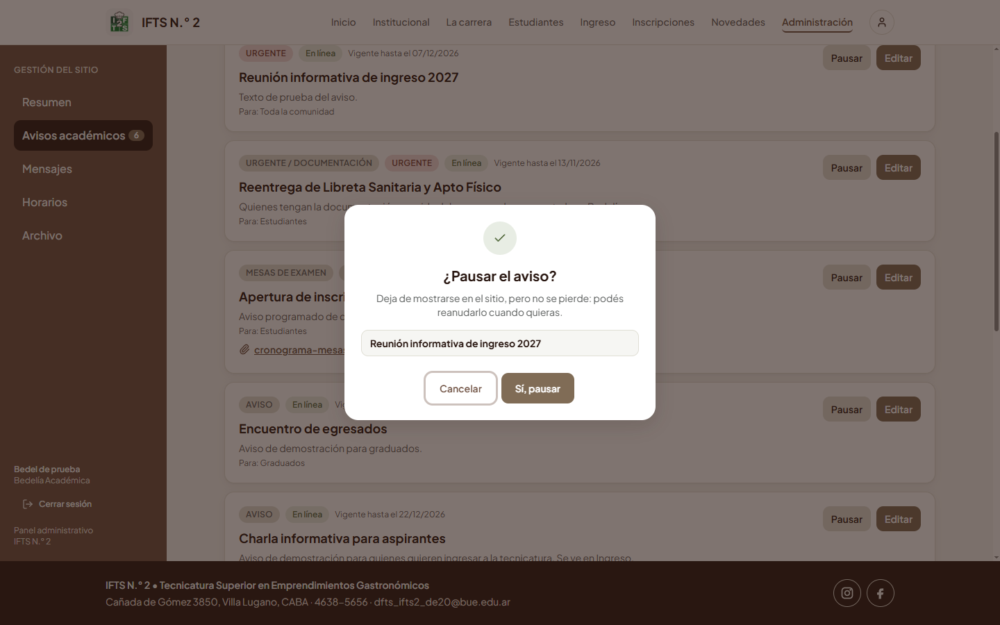

### 5.4 Cargar horarios y llamados a examen _(Bedelía)_

1. Entrá a **Horarios**. Arriba elegís el **ciclo que estás editando**; los cambios de esa pantalla se ven en el sitio solo si ese ciclo es el **público**.
2. **Grilla de cursada**: tocá **Cargar nueva grilla**, elegí la **Comisión**, adjuntá el **Archivo de la grilla** (PDF) y, si querés, una nota para el estudiante. Después tocá **Publicar** en la tarjeta (con confirmación). **Despublicar** la oculta sin borrarla.
3. **Llamado a examen**: tocá **Configurar nuevo llamado**. Completá la **Denominación del turno**, las fechas de **Apertura y Cierre SIU Guaraní**, tildá **Inscripción abierta** si corresponde, y **Destacar en el Inicio del sitio** para que aparezca en la portada. Podés adjuntar el cronograma oficial (PDF).
4. **Actualizar archivo / comisión** y **Editar llamado a examen** permiten corregir lo cargado.

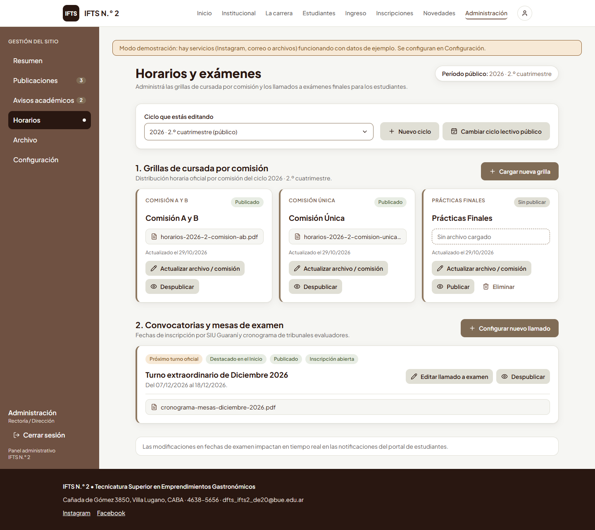

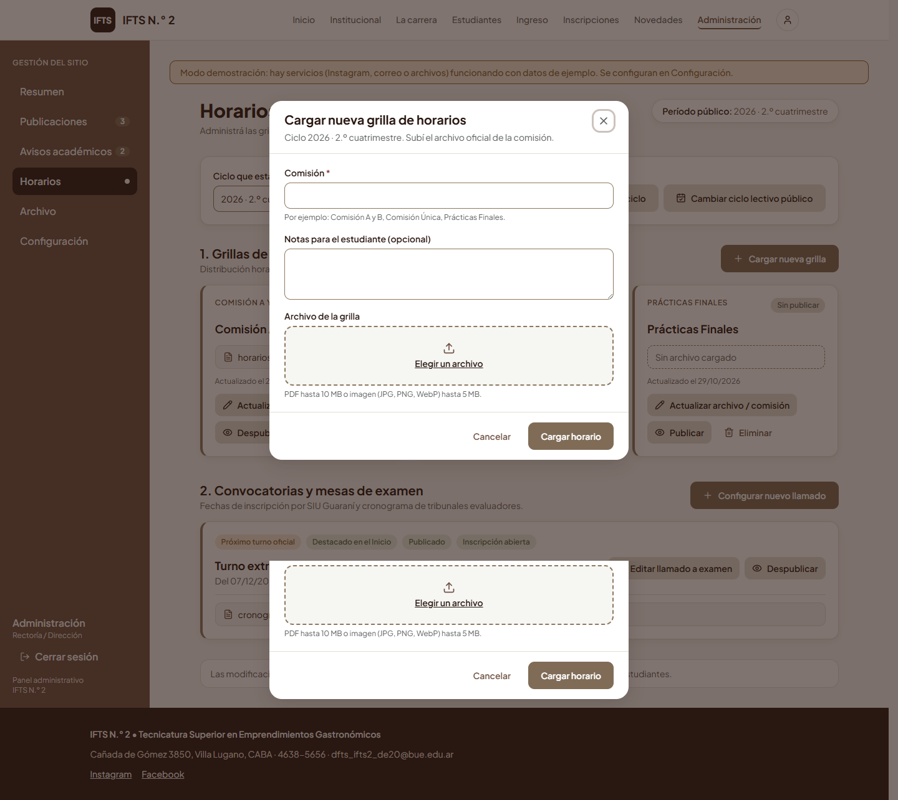

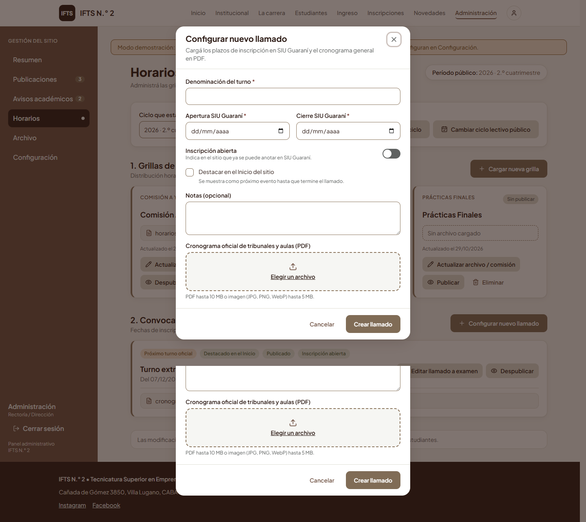

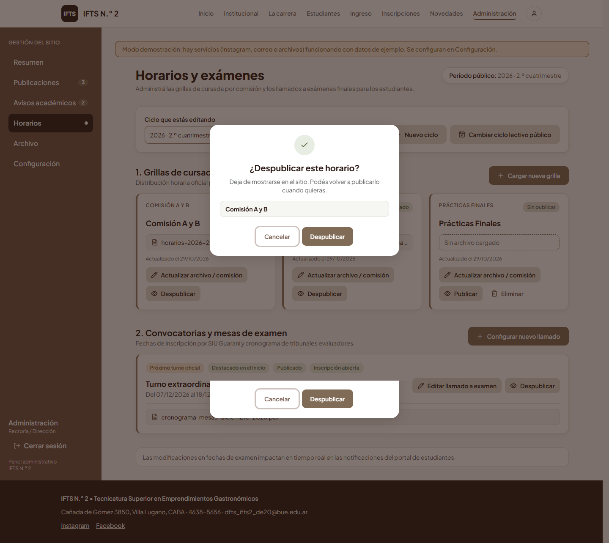

### 5.5 Cambiar el ciclo público _(solo Administración)_

El **ciclo público** es el período (por ejemplo «2026 · 2.º cuatrimestre») cuyos horarios y llamados ve el público. Solo uno puede ser el público a la vez.

1. En **Horarios**, si el ciclo nuevo no existe, tocá **Nuevo ciclo** y cargalo (año y período).
2. Tocá **Cambiar ciclo lectivo público**, elegí el **Nuevo ciclo público** y tocá **Continuar**.
3. Leé la advertencia y confirmá con **Sí, cambiar ciclo**. Lo del ciclo anterior **no se borra**: queda guardado y deja de verse en el sitio.

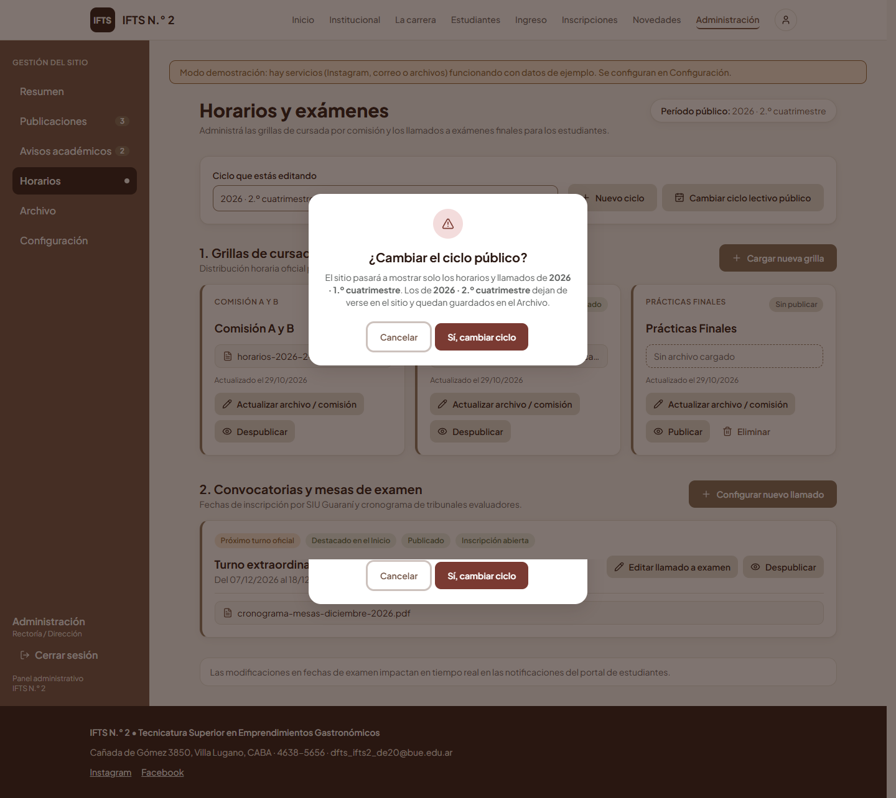

### 5.6 Archivar, restaurar y eliminar un documento _(Bedelía)_

La pantalla **Archivo** guarda la documentación histórica. Por defecto muestra los documentos **archivados**.

1. **Buscar**: escribí el título, el año o el código de resolución. También podés filtrar por **Tipo**, **Ciclo** y **Estado**.
2. **Ver detalle**: muestra los datos del documento y **dónde se usa** (avisos, horarios o llamados que lo adjuntan).
3. **Archivar un documento nuevo**: tocá **Archivar nuevo documento**, elegí el **Archivo**, escribí el **Título**, completá tipo, ciclo y demás datos, y tocá **Guardar documento**. Con la casilla **Archivar ahora** tildada queda directamente en el archivo histórico.
4. **Restaurar**: en el detalle, tocá **Restaurar** y confirmá. Vuelve a estar vigente.
5. **Archivar** un documento vigente: tocá **Archivar** y confirmá. Si está adjunto a algo que hoy se muestra, el sistema te avisa y podés elegir «Archivar de todos modos».
6. **Eliminar definitivamente**: solo aparece en documentos **archivados** y que **no están en uso**. Tocá el botón, leé el aviso («No se puede deshacer») y confirmá. Queda registrado quién lo eliminó y cuándo.

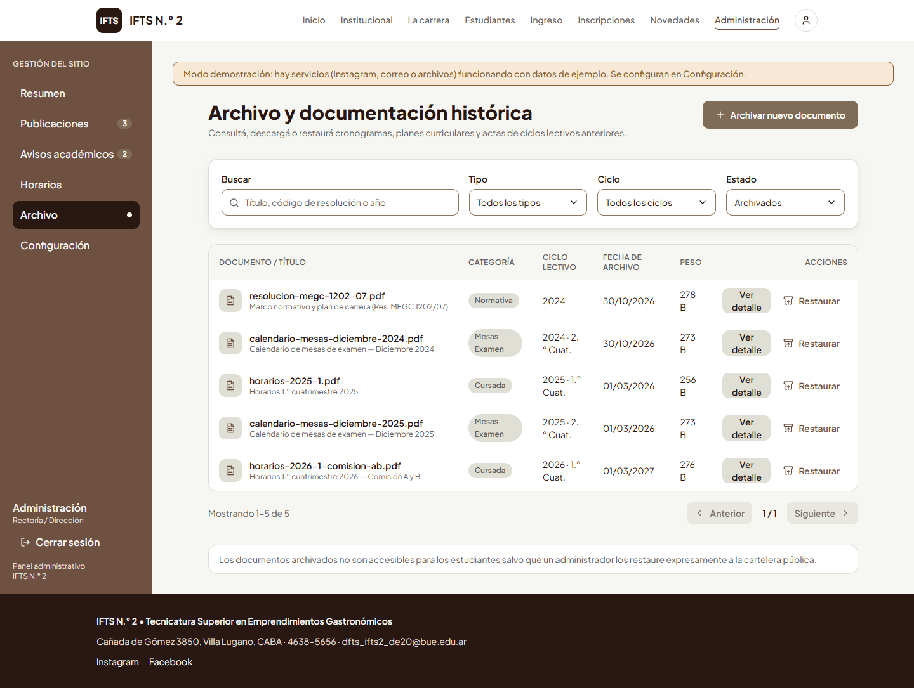

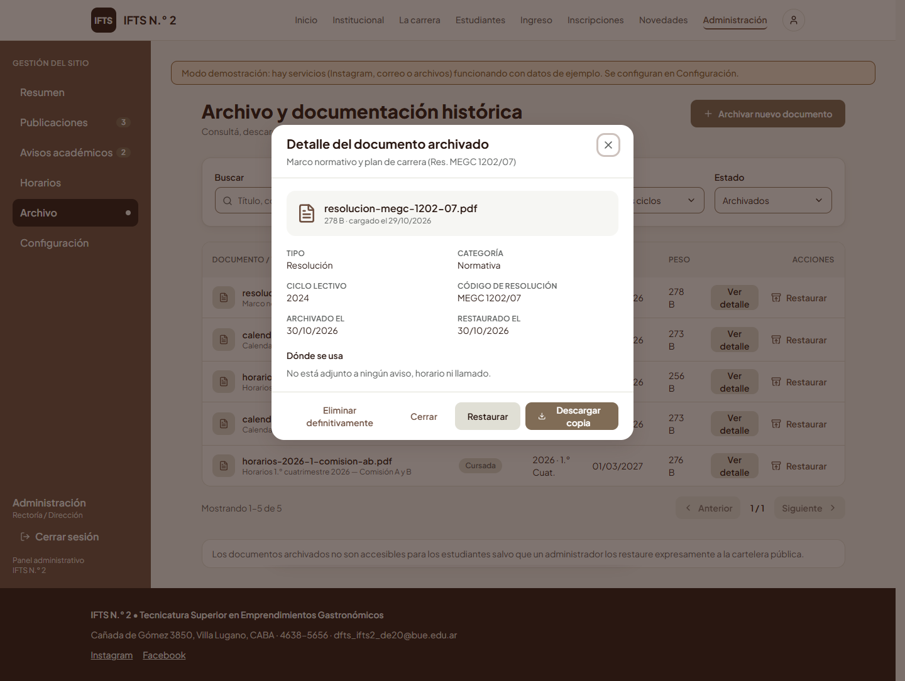

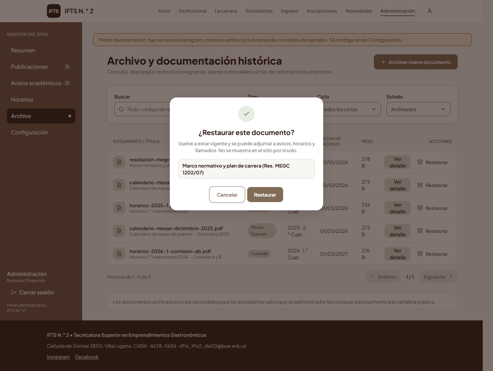

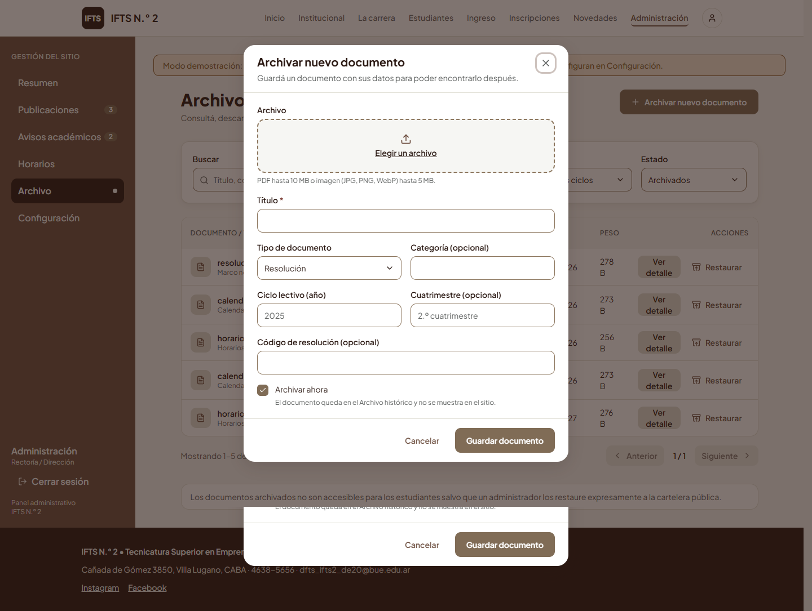

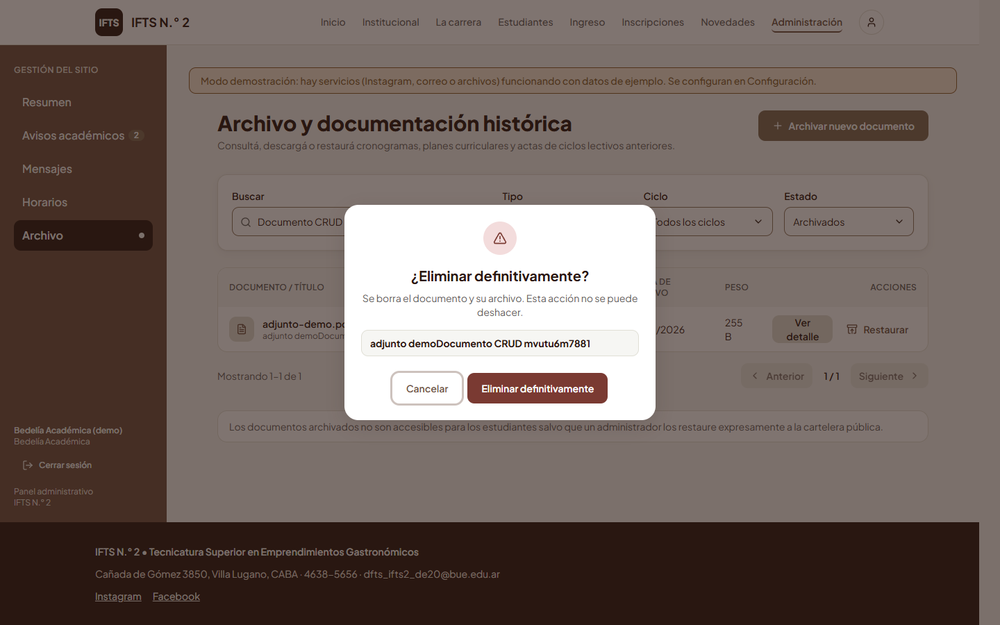

### 5.7 Administrar usuarios y roles _(solo Administración)_

1. Entrá a **Configuración** y tocá **Administrar usuarios y roles**.
2. **Crear**: completá **Nombre y apellido**, **Correo electrónico** y **Rol**, y tocá **Crear usuario**. El sistema muestra una **clave temporal una sola vez**: copiala (botón **Copiar**) y pasásela a la persona. Al ingresar, tendrá que cambiarla.
3. **Cambiar el rol**: en la fila de la persona, elegí el nuevo rol en el desplegable.
4. **Restablecer contraseña**: genera una nueva clave temporal (con confirmación).
5. **Desactivar**: la persona deja de poder ingresar. **Los usuarios no se eliminan**, se desactivan, para conservar el registro de lo que hicieron. Se puede **Reactivar** cuando haga falta.
6. No se puede repetir un correo: verás «Ya existe un usuario con ese correo».
7. La Administración ofrece solo los roles cuyos permisos ella misma tiene y nunca «Superadministrador». El último Superadministrador activo no se puede desactivar ni cambiar de rol.

#### Roles y permisos _(solo Superadministrador)_

En **Configuración → Seguridad y accesos** (o en el menú lateral, ítem **Roles y permisos**) el Superadministrador ve la lista de roles y cuántas personas tiene cada uno.

1. **Nuevo rol**: poné un nombre, tildá lo que ese rol puede hacer (las casillas están agrupadas por recurso) y tocá **Crear rol**.
2. **Editar permisos**: abrí un rol, cambiá las casillas y **Guardar cambios**; el cambio rige en el próximo pedido de cada persona, sin que tenga que volver a ingresar.
3. **Eliminar**: pide confirmación y solo se puede si el rol no tiene personas asignadas («Reasigná a los usuarios antes de eliminar el rol»). Se pueden eliminar también Administración, Bedelía y Comunicación; **Superadministrador no se edita ni se elimina**.

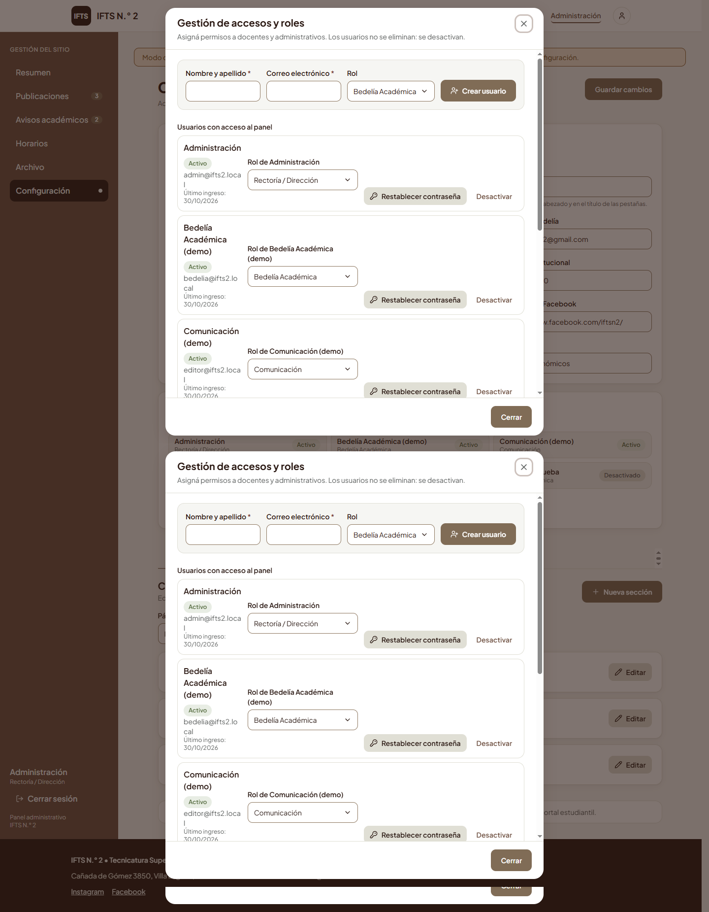

### 5.8 Configurar Instagram y el correo _(requiere el permiso «Integraciones»; Administración lo tiene por defecto)_

Entrá a **Configuración** y abrí la pestaña **Integraciones**. Allí se conectan los servicios externos; mientras no se configuren, el sitio funciona en **modo demostración** con datos de ejemplo.

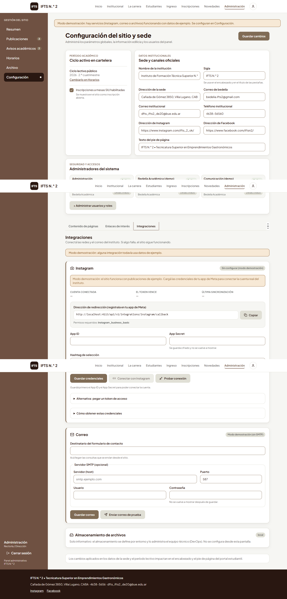

#### Guía para el cliente: conectar Instagram

Instagram exige que el instituto tenga **su propia app** en Meta (la empresa dueña de Instagram y Facebook). Es gratuito y se hace una sola vez:

1. **Usá una cuenta profesional.** La cuenta de Instagram del instituto tiene que ser profesional (Empresa o Creador). Se cambia desde _Configuración y privacidad_ de Instagram, sin costo.
2. **Creá la app en Meta for Developers.** Ingresá a developers.facebook.com con una cuenta de Facebook, elegí **Crear app** y seleccioná el caso de uso de Instagram. Guardá el nombre de la app.
3. **Agregá el producto Instagram** (inicio de sesión de Instagram) a la app.
4. **Registrá la dirección de redirección.** En el panel, en **Configuración → Integraciones → Instagram**, copiá la «Dirección de redirección» con el botón **Copiar** y pegala en Meta, en «URI de redireccionamiento de OAuth válidos».
5. **Copiá el App ID y el App Secret** de tu app y pegalos en el panel (campos **App ID** y **App Secret**). Escribí también el **Hashtag de selección** que usa el instituto. Tocá **Guardar credenciales**. El App Secret se guarda cifrado y no se vuelve a mostrar.
6. Tocá **Conectar con Instagram**, iniciá sesión con la cuenta del instituto y aceptá los permisos. Después tocá **Probar conexión**: si todo está bien, verás la cuenta conectada y la fecha en que vence el acceso (el sistema lo renueva solo).

_Alternativa:_ en lugar del paso 6 podés usar **Alternativa: pegar un token de acceso** (un token de larga duración generado en Meta).

Estados que vas a ver: **Sin configurar (modo demostración)** · **Credenciales guardadas** (falta conectar) · **Conectada** · **Token por vencer** · **Error**. Para volver al modo demostración usá **Desconectar**.

> **Importante:** esta conexión depende de la cuenta y la app de Meta del instituto. En esta entrega se probó con datos de demostración y un servidor simulado, no con la cuenta real (ver «Limitaciones» en el Manual Técnico). Si Instagram falla, el sitio sigue funcionando y podés **cargar publicaciones manualmente** (sección 5.2).

#### Correo del formulario de contacto

1. En la tarjeta **Correo**, escribí el **Destinatario del formulario de contacto**: ahí llegarán los avisos de consultas.
2. Opcional: completá el **Servidor SMTP** (host, puerto, usuario y contraseña) que te dé el área de sistemas o tu proveedor de correo.
3. Tocá **Guardar correo** y después **Enviar correo de prueba** para comprobar que llega.

Aunque el correo falle, **las consultas igual quedan guardadas** en **Mensajes**.

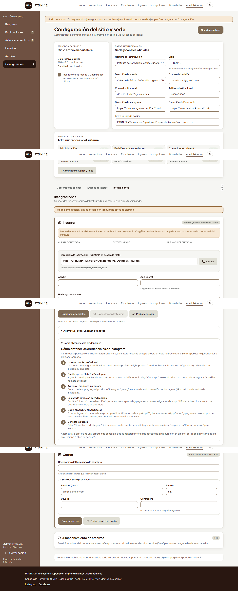

### 5.9 Leer los mensajes de contacto _(Bedelía)_

En **Mensajes** aparecen las consultas enviadas desde el sitio. Podés filtrarlas por estado y marcarlas como **leídas** o **respondidas**. Solo la Administración puede eliminar mensajes (y solo los respondidos).

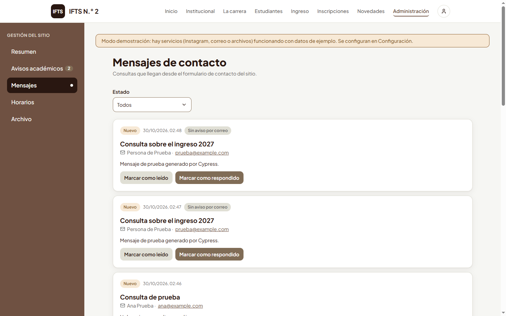

### 5.10 Otras opciones de Configuración _(Administración)_

- **Datos de la sede y canales oficiales**: nombre, dirección, correos, teléfono, redes y texto del pie. Tocá **Guardar cambios** y confirmá (afectan a todo el sitio).
- **Contenido de páginas**: textos de Institucional, La carrera e Ingreso, con vista previa.
- **Enlaces de interés**: SIU Guaraní, Aulas Virtuales, etc.

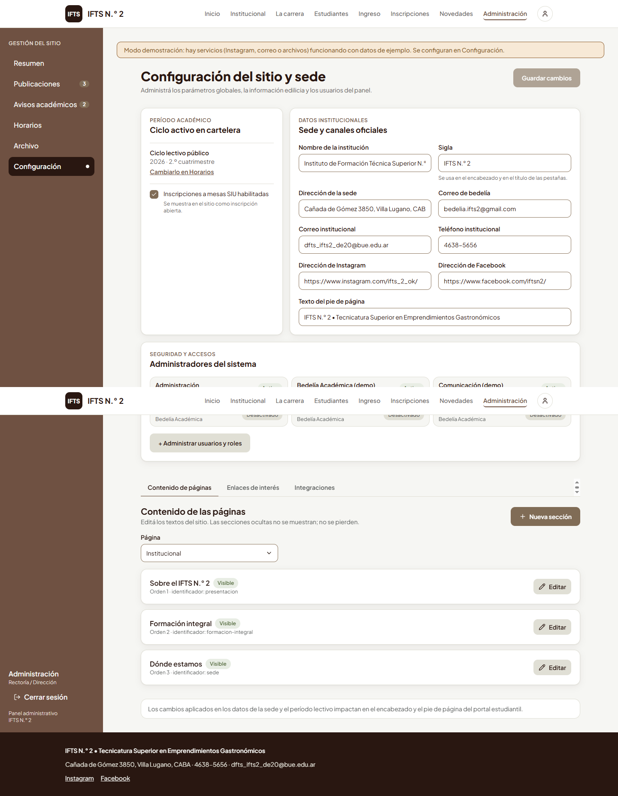

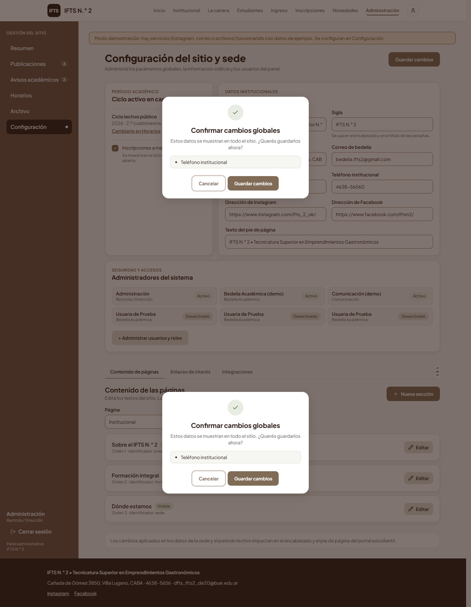

## 6. Operaciones de datos (crear, leer, actualizar y eliminar)

Esta sección muestra, con la aplicación real, las cuatro operaciones sobre **avisos, publicaciones, documentos y usuarios**, junto con las reglas que las protegen. Las capturas fueron generadas por una prueba automática (`apps/web/cypress/e2e/panel-a/capturas-crud.cy.ts`) que recorre cada paso con la interfaz.

### 6.1 Reglas que valen para todo

| Regla                              | Cómo se ve                                                                                                          |
| ---------------------------------- | ------------------------------------------------------------------------------------------------------------------- |
| **Campos obligatorios**            | Si falta un dato, aparece un mensaje claro debajo del campo («El título es obligatorio.») y no se guarda nada       |
| **No duplicados**                  | No se repite el correo de un usuario, ni un ciclo lectivo, ni una categoría; el sistema lo explica                  |
| **Confirmación antes de eliminar** | Siempre aparece una ventana «¿Eliminar…?» con **Cancelar** y **Sí, eliminar**; cancelar no cambia nada             |
| **Solo se elimina lo no vigente**  | Un aviso o publicación vigente no ofrece «Eliminar»: primero se pausa (o espera a que venza)                        |
| **Auditoría**                      | Cada alta, cambio o baja registra quién lo hizo y cuándo                                                            |
| **Mensajes claros**                | Los errores explican el problema y qué hacer, sin códigos técnicos                                                  |

### 6.2 Avisos académicos

| Operación       | Cómo                                                                                | Captura |
| --------------- | ----------------------------------------------------------------------------------- | ------- |
| **Crear**       | **Nuevo aviso** → completar título y contenido → **Publicar aviso** → **Sí, publicar** | 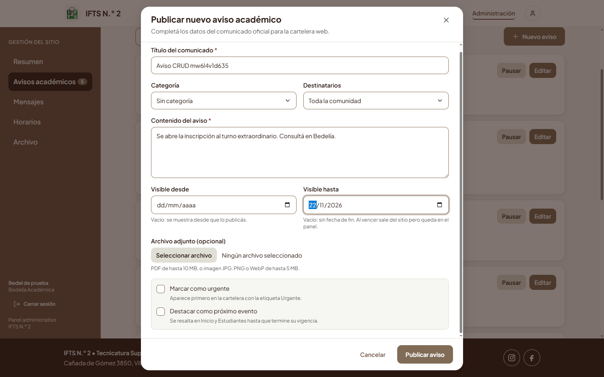 |
| **Leer**        | La lista de **Avisos académicos** (con filtros y conteos) y el sitio público **Estudiantes** | 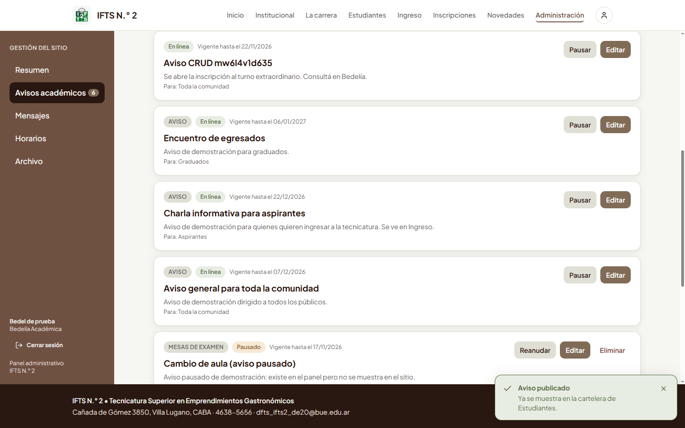 |
| **Actualizar**  | **Editar** → cambiar los datos → **Guardar cambios** → **Sí, guardar**               | 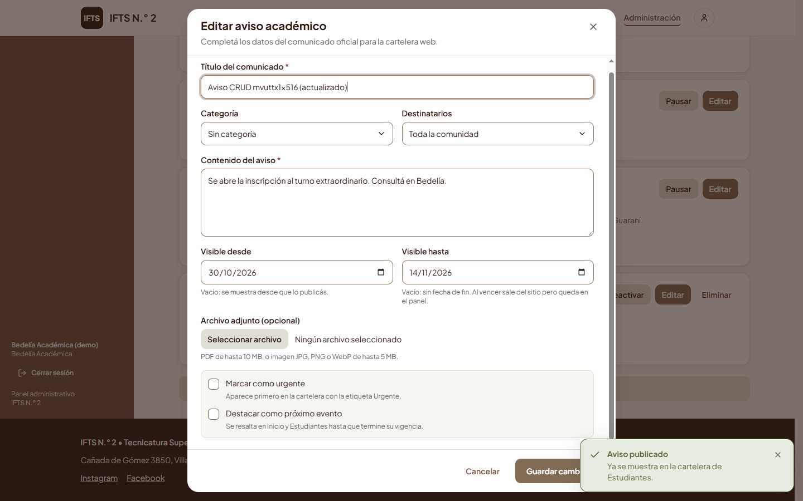 |
| **Eliminar**    | Si está vigente: **Pausar** primero. Luego **Eliminar** → **Sí, eliminar**           | 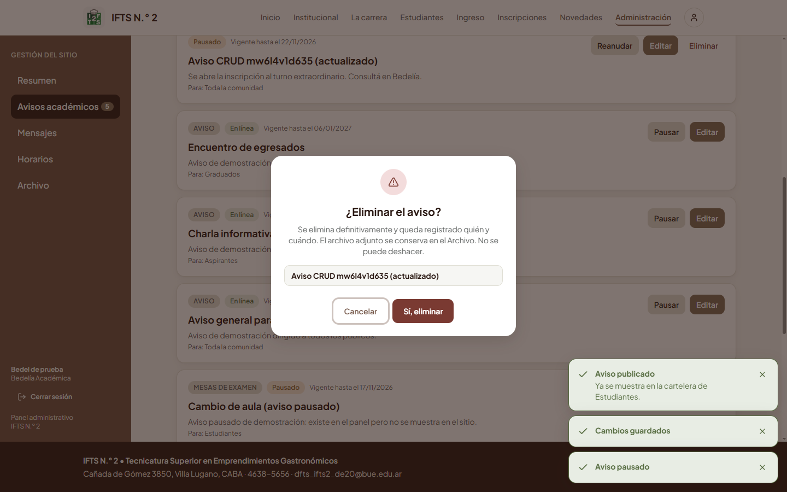 |

### 6.3 Publicaciones propias

| Operación       | Cómo                                                                                | Captura |
| --------------- | ----------------------------------------------------------------------------------- | ------- |
| **Crear**       | **Propias del sitio → Nueva publicación** → título y resumen → **Crear borrador**    | 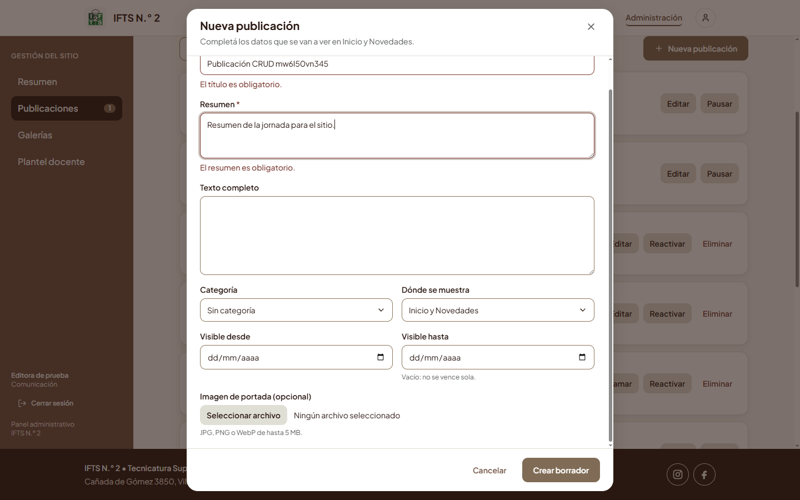 |
| **Leer**        | La lista de publicaciones propias con su estado (Borrador, En línea, Pausada)       | 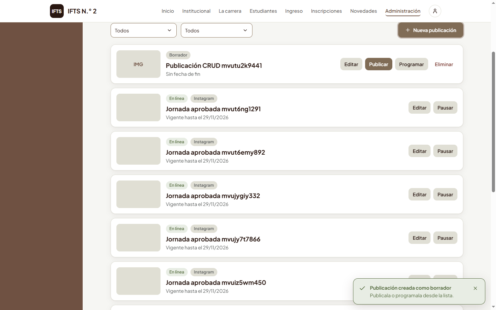 |
| **Actualizar**  | **Editar** → cambiar datos → **Guardar cambios**                                    | 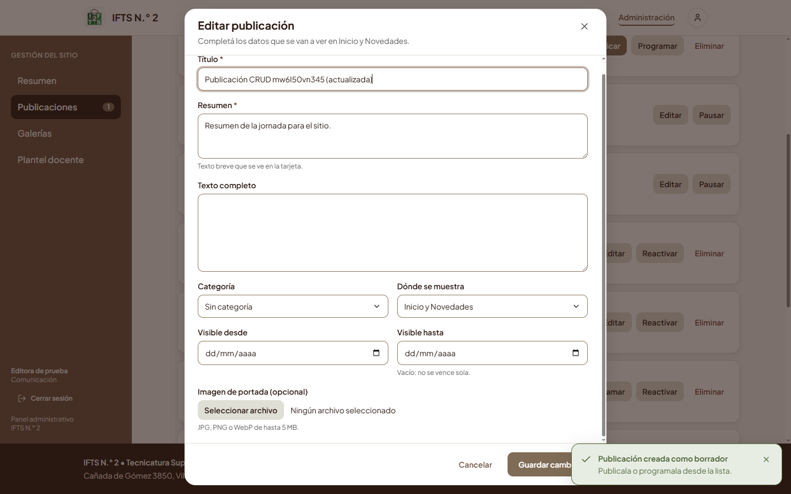 |
| **Eliminar**    | **Eliminar** (solo borrador, pausada o vencida) → **Sí, eliminar**                  | 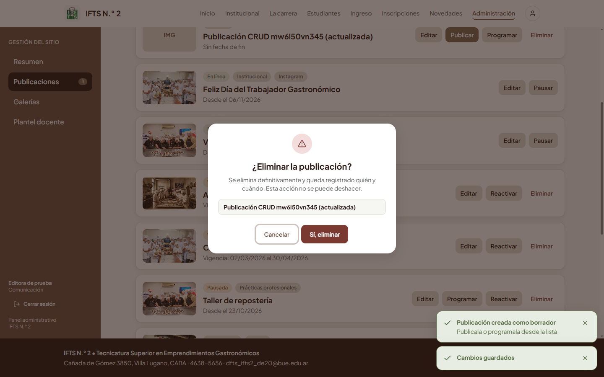 |

### 6.4 Documentos del archivo

| Operación       | Cómo                                                                                | Captura |
| --------------- | ----------------------------------------------------------------------------------- | ------- |
| **Crear**       | **Archivar nuevo documento** → elegir archivo y completar datos → **Guardar documento** | 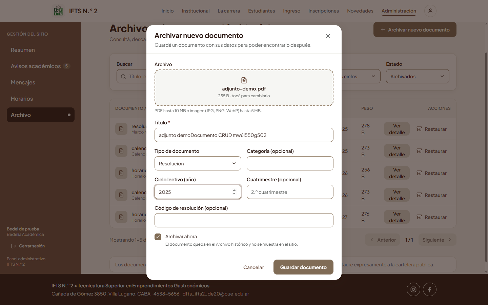 |
| **Leer**        | **Buscar** y **Ver detalle** (datos y dónde se usa)                                  | 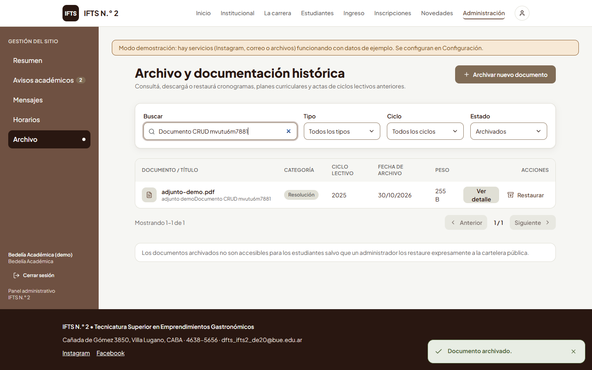 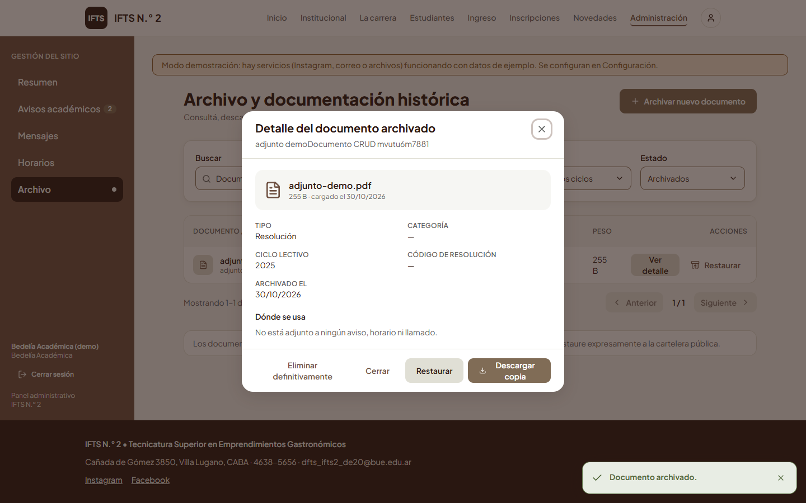 |
| **Actualizar**  | Cambiar su estado: **Restaurar** (vuelve a estar vigente) o **Archivar**             |  |
| **Eliminar**    | Solo archivados y sin uso: **Eliminar definitivamente** → confirmar                  |  |

### 6.5 Usuarios

| Operación            | Cómo                                                                              | Captura |
| -------------------- | --------------------------------------------------------------------------------- | ------- |
| **Crear**            | **Administrar usuarios y roles** → nombre, correo y rol → **Crear usuario**        |  |
| **Leer**             | La lista de usuarios con rol, estado y último ingreso; aviso si el correo ya existe |  |
| **Actualizar**       | Cambiar el **rol** en el desplegable, o **Restablecer contraseña**                  |  |
| **Eliminar (desactivar)** | **Desactivar** → confirmar. No se borra para conservar la auditoría; se puede **Reactivar** |   |

## 7. Mensajes y alertas frecuentes

| Mensaje que ves                                                           | Qué significa                                                      | Cómo resolverlo                                                                                  |
| ------------------------------------------------------------------------- | ------------------------------------------------------------------ | ------------------------------------------------------------------------------------------------ |
| «Correo o contraseña incorrectos.»                                        | Los datos de ingreso no coinciden                                  | Revisá mayúsculas y el correo. Si no recordás la clave, pedile una temporal al administrador     |
| «Hiciste demasiados intentos seguidos. Esperá unos minutos…»              | Se bloqueó el ingreso por seguridad (5 intentos fallidos)          | Esperá unos 15 minutos y volvé a intentar                                                        |
| «No tenés permiso» / «No tenés permiso para realizar esta acción.»        | Tu rol no incluye esa pantalla o acción                            | Pedile al administrador que te asigne el rol adecuado                                            |
| «Modo demostración: hay servicios… funcionando con datos de ejemplo»      | Instagram, correo o archivos todavía no están configurados          | La Administración los configura en **Configuración → Integraciones** (sección 5.8)               |
| «El título es obligatorio.» / «El texto del aviso es obligatorio.»        | Falta un dato requerido                                            | Completá el campo marcado y volvé a guardar                                                      |
| «La fecha de fin debe ser posterior a la fecha de inicio.»                | Las fechas de vigencia están al revés                              | Corregí las fechas                                                                               |
| «Confirmá que existe consentimiento para publicar imágenes de estudiantes.» | No tildaste el consentimiento al aprobar una publicación         | Tildá la casilla (confirmando que existe el consentimiento) y volvé a aprobar                     |
| «Ese tipo de archivo no está permitido»                                   | Intentaste subir un archivo que no es PDF, JPG, PNG ni WebP         | Convertí el archivo a PDF o imagen                                                               |
| «…el máximo es 10,0 MB»                                                   | El archivo es muy pesado                                           | Reducí su tamaño (por ejemplo, exportá el PDF con menor calidad)                                 |
| «Ya existe un usuario con ese correo»                                     | Ese correo ya tiene una cuenta                                     | Usá otro correo, o reactivá la cuenta existente                                                  |
| «No se puede eliminar un aviso vigente. Pausalo o esperá a que venza.»    | Solo se elimina lo que ya no está en circulación                   | Pausá el aviso y luego eliminalo                                                                 |
| «Solo se pueden eliminar documentos archivados. Archivalo primero.»       | Intentaste eliminar un documento vigente                           | Archivalo y luego eliminalo (si no está en uso)                                                  |
| «Elegí la nueva fecha de fin.»                                            | Al reactivar un aviso o publicación vencida hace falta una fecha   | Elegí una fecha futura de fin                                                                    |
| «Para enviar la consulta tenés que aceptar el aviso de uso de datos personales.» | (Sitio público) No tildaste la casilla del formulario       | Tildala y enviá de nuevo                                                                         |
| «Enviaste varias consultas en poco tiempo. Esperá un rato…»               | (Sitio público) Límite de envíos por hora                          | Esperá y probá más tarde                                                                         |
| «Algo salió mal de nuestro lado. Intentá de nuevo en unos minutos.»       | Error inesperado del sistema                                       | Reintentá. Si persiste, avisá al equipo técnico                                                  |
| Estado de Instagram «Error» o «Token por vencer»                          | La conexión con Instagram falló o está por vencer                   | Probá **Probar conexión**; si sigue, **Conectar con Instagram** de nuevo. Mientras tanto cargá publicaciones manualmente |
| Un aviso o llamado «no aparece en el sitio»                               | Está pausado, vencido, sin publicar, o su ciclo no es el público    | Revisá su estado en el panel y el ciclo público en **Horarios**                                  |

## 8. Glosario

- **Ciclo público**: el período lectivo cuyos horarios y llamados se muestran en el sitio.
- **Vigente**: contenido que hoy se muestra (activo y dentro de sus fechas).
- **Pausar**: sacar algo de circulación sin borrarlo.
- **Archivar**: guardar un documento en el archivo histórico, fuera del sitio.
- **Moderar**: revisar y decidir si una publicación de Instagram se muestra en el sitio.
- **Modo demostración**: el sitio funciona con datos de ejemplo hasta que se configuren las integraciones.
